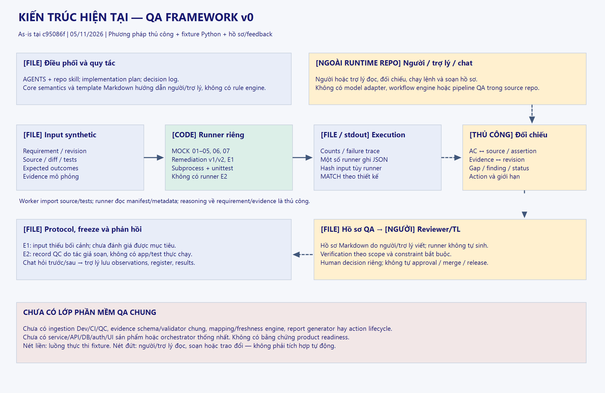
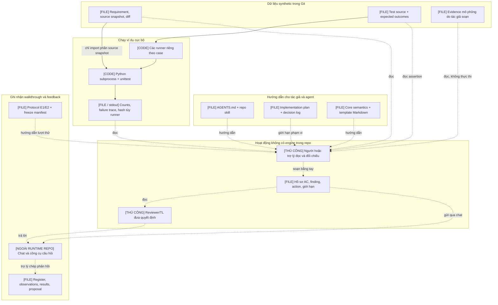
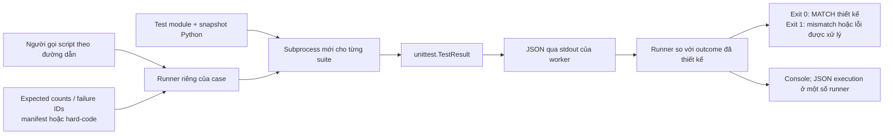
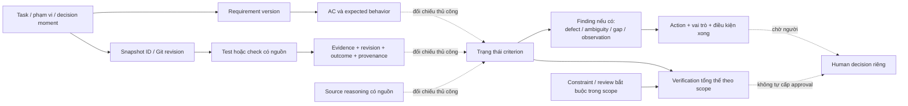

# Kiến trúc hiện tại — QA framework v0

Ngày 05/11/2026. Mốc khảo sát `c95086f`. Đây là kiến trúc **as-is**, không phải kiến trúc sản phẩm đích. Phạm vi: tài liệu phương pháp, template, toàn bộ nhóm runner, evidence, protocol và workflow chat trong repo.

**Kết luận:** hiện có bộ phương pháp review thủ công, artifact minh họa và các chương trình kiểm tra fixture riêng lẻ. Chưa có một ứng dụng/framework runtime xử lý task bàn giao từ đầu đến cuối. Chưa đủ nền tảng để coi repo là sản phẩm sẵn sàng pilot vận hành. Việc tồn tại đầy đủ file deliverable hoặc test fixture pass không chứng minh product readiness.



## 1. Sơ đồ tổng thể: thành phần thực sự tồn tại

Chữ `[FILE]` là artifact lưu trong repo; `[CODE]` là chương trình Python chạy được; `[THỦ CÔNG]` là người hoặc trợ lý thực hiện. Mũi tên nét đứt là liên hệ đọc/ghi do người thực hiện, không có service tự nối luồng.



Không có mũi tên tự động từ runner tới hồ sơ AC/finding. Runner không hiểu requirement dạng Markdown hoặc đánh giá quyết định người đọc. Trợ lý sử dụng model trong phiên chat là công cụ tác giả; không có AI adapter/model runtime được triển khai trong repo.

## 2. Bản đồ module và trách nhiệm

| Nhóm | File/thư mục | Vai trò thực tế | Không thực hiện |
|---|---|---|---|
| Điều phối phát triển | `AGENTS.md`, `.agents/skills/qa-framework-development/SKILL.md` | Hướng dẫn agent giữ scope, snapshot và bàn giao | Không là orchestrator hoặc kiểm soát được thực thi bằng code |
| Phương pháp | `docs/CORE-FRAMEWORK.md` | Quy tắc AC/evidence/status/finding/action | Không có parser hoặc engine áp quy tắc |
| Đầu ra mẫu | `templates/quality-record.md` | Form Markdown cho người/trợ lý điền | Không có schema validation hay report generator |
| Kế hoạch/quyết định | `docs/IMPLEMENTATION-PLAN.md`, `docs/DECISION-LOG.md` | Scope, gates và lý do lựa chọn | Không tự đánh dấu gate hoặc điều phối job |
| Mock 01–05 | `examples/mock/manifest.json`, `examples/mock/run.py` | Chạy 5 fixture, kiểm diff/count với đáp án | Không tự tìm bug, không xác minh toàn bộ claim trong JSON/Markdown |
| Mock 06 | `examples/mock/06-filter-pagination/` | Mô phỏng UI state/API/cache/service trong một process | Không có browser, HTTP API, DB hoặc deploy |
| Remediation 06 | `examples/remediation/06-filter-pagination*/` | Snapshot sửa riêng và kiểm đối chứng | Không phải workflow tự sửa code |
| Mock 07 | `examples/mock/07-order-discount/` | Hàm tính giá synthetic và test đối chứng | Không là service thanh toán hoặc domain engine |
| E1 | `examples/evaluation/e1-seat-cancellation/` | Code đặt/hủy chỗ nhỏ, 2 baseline, input review | Không có pipeline QC hay so sánh trước/sau hồ sơ được hoàn tất |
| E2 | `examples/evaluation/e2-qc-handoff/` | Gói tài liệu QC → TL với record giả lập | Không có app CSV, self-test/QC đã thực chạy hoặc runner |
| Hồ sơ | `pilot/mock/*.md`, `pilot/e2-01-review.md` | Phân tích do trợ lý soạn và đối chiếu | Không phải output được engine tự sinh |
| Theo dõi | `pilot/task-register.md`, `pilot/adjudication-log.md`, observations/results | Nhật ký Markdown thủ công | Không là database/workflow engine hoặc adjudication độc lập |
| Đóng băng | `pilot/e1-freeze.json` | Định danh core/template bằng commit/blob/hash Git | Không đóng băng toàn bộ repo, E2 input hoặc mọi evidence |
| Tổng kết/đề xuất | `pilot/results.md`, `docs/MANAGEMENT-PROPOSAL.md` | Ghi bằng chứng, giới hạn, đề xuất | Không là chứng nhận readiness hoặc phê duyệt nguồn lực |

## 3. Luồng thực thi của các runner



| Entry point | Phạm vi | Cách so outcome | Output thực tế |
|---|---|---|---|
| `examples/mock/run.py` | MOCK-01–05, 14 lượt thực thi test theo manifest | Kiểm diff before/after; so số tests/failures/errors/skipped | Console và exit; không tự ghi execution JSON/hash; không so failure ID |
| `examples/mock/06-filter-pagination/run.py` | base/head × baseline 6 + historical 1 + probe 2 = 18 lượt | Kiểm inventory/diff; counts và failure IDs dự kiến, không error/skipped | Console + `execution.local.json`, timestamp/Python/hash/trace; ghi đè khi chạy lại |
| `examples/remediation/06-filter-pagination/run.py` | head lỗi/fixed-v1 × 9 = 18 lượt | Reuse WORKER của runner 06 bằng `runpy`; expected IDs hard-code | Console + execution JSON/hash; không kiểm diff riêng giữa head/fixed |
| `examples/remediation/06-filter-pagination-v2/run.py` | fixed-v1/fixed-v2 × 13 = 26 lượt | Reuse WORKER 06, sửa chuỗi sys.path để thêm 4 test; expected IDs hard-code | Console + execution JSON/hash |
| `examples/mock/07-order-discount/run.py` | head/fixed × 4 = 8 lượt | Counts/failure IDs hard-code | Console + execution JSON/hash |
| `examples/evaluation/e1-seat-cancellation/run_baseline.py` | head, chỉ 2 baseline | Yêu cầu đúng 2 test, không failure/error/skipped | `baseline.local.json`, hashes và console |
| E2 | Không có code thực thi | Người đọc đối chiếu record theo protocol | Markdown và JSON evidence do tác giả soạn |

Các số trên là **lượt test**, không là số case độc lập, số lỗi hoặc số yêu cầu được phủ. `MATCH` có thể bao gồm assertion fail cố ý. Worker dùng `unittest.TestResult` nên assertion fail được serialize; process worker vẫn có thể exit 0. Runner mới là nơi so outcome và quyết định exit cuối.

Không có lệnh chung chạy toàn bộ các nhóm. `examples/mock/run.py` không tự chạy 06/07/remediation/E1/E2. Không có package runtime chung cho các runner; code worker bị lặp và remediation phụ thuộc cấu trúc/internal string của runner 06.

Subprocess giúp tách import/state giữa suite, **không là sandbox chạy mã không tin cậy**. Test/source được chạy như Python cục bộ với quyền process; timeout không cung cấp cô lập filesystem/network. Scope hiện chỉ cho synthetic do tác giả biết rõ.

## 4. Luồng nghiệp vụ QA hiện tại: ai thực hiện?

```mermaid
sequenceDiagram
  participant A as Người hoặc trợ lý soạn case
  participant R as Runner fixture nếu có
  participant P as Người hoặc trợ lý chuẩn bị hồ sơ
  participant T as Người dùng Reviewer/TL
  participant G as File trong checkout Markdown/Python/JSON
  A->>G: Requirement, snapshot, tests hoặc record mô phỏng
  opt Case có Python/test thực thi
    A->>R: Gọi script riêng theo case
    R->>G: Ghi execution JSON nếu runner hỗ trợ
    R-->>A: Console / exit / outcome
  end
  P->>G: Đọc requirement + source + assertions + evidence
  P->>P: Chọn AC, đối chiếu và reasoning thủ công
  opt Cần targeted check hoặc clarification
    P->>A: Đề xuất check nhỏ hoặc làm rõ yêu cầu
    opt Có check được phép và thực sự được chạy
      A->>R: Chạy check nếu có runner phù hợp
      R-->>P: Kết quả check cục bộ
    end
    P->>G: Cập nhật record hoặc clarification pending; thay code/requirement thì version mới
  end
  alt Walkthrough QA thông thường
    P->>G: Soạn quality record bằng template
    P->>T: Gửi hồ sơ để người đọc quyết định
  else Nhánh đánh giá bổ sung E2
    P->>T: Gửi input ban đầu / câu hỏi qua chat
    T-->>P: Nhận định trước hồ sơ
    P->>G: Lưu nguyên phản hồi trước
    P->>G: Sau đó soạn hồ sơ bằng template frozen
    P->>T: Gửi hồ sơ tổng hợp
    T-->>P: Nhận định sau / feedback
    P->>G: Chép feedback, giới hạn và results
  end
```

Gói E2 đặt developer self-test/QC trong **vai trò giả lập của dữ liệu**; không có hai actor phần mềm hoặc hai nhóm QA độc lập trong sequence thực thi. Trợ lý tạo record, người dùng đọc và trả lời. Mô hình GPT/ứng dụng chat không nằm trong source runtime repo.

## 5. Mô hình dữ liệu hiện tại

Đây là quan hệ khái niệm được diễn đạt bằng link/nhãn trong Markdown và JSON. Chưa có database schema, foreign key hoặc validator bảo đảm các quan hệ.



Trạng thái criterion: `verified`, `failed`, `unverified`, `not_applicable`. Verification tổng thể: `complete`, `incomplete`, `failed`; có thể failed đồng thời còn phần unverified. `pass/fail/error/skipped` là kết quả test, không đồng nhất với các trạng thái này. E2 `blocked` là outcome record mô phỏng, chưa có normalized enum chung với runner.

Source reasoning đủ mạnh có thể xác nhận defect mà không đợi test fail; phải ghi nguồn và giới hạn. Human decision vẫn riêng, nhưng constraint review bắt buộc trong scope có thể làm verification incomplete: MOCK-01 complete và human pending; MOCK-05 behavior AC verified nhưng P-05 domain/security review chưa xong nên verification incomplete, human decision cũng pending. Không đồng nhất mọi approval pending với incomplete, cũng không bỏ qua constraint đã khai báo.

Finding có category và verdict; action có owner/vai trò. Mã AC/check/snapshot không được kiểm duyệt bằng schema. Một số expected review là chuỗi trong manifest; chỉ in ra chứ không được so với hồ sơ người đọc. Không có cách máy xác nhận “verified” có nguồn đúng, deduplicate hoặc kiểm action đã xong.

## 6. Ba loại evidence và ranh giới tin cậy

| Loại | Ví dụ | Có thể khẳng định | Không thể khẳng định |
|---|---|---|---|
| Evidence tác giả soạn | `evidence.mock.json` ở MOCK/E2 | Một input mô phỏng cho reasoning | Developer/QC thật đã test hoặc app thật đã pass |
| Execution local | `execution.local.json`, `baseline.local.json` | Python synthetic được chạy, kết quả theo file đã ghi | QC độc lập, production behavior, full requirement coverage |
| Reasoning/feedback | Hồ sơ Markdown, câu trả lời chat | Người chuẩn bị giải thích; người dùng đã phản hồi nội dung cụ thể | Model tự xác minh được claim, approval thật hoặc hiệu quả đã đo |

Hashes ở runner được tính từ bytes file trong working tree; có thể khác khi newline thay đổi qua OS/checkout. Freeze manifest E1 tính hash từ blob Git để tránh riêng vấn đề newline của artifact frozen. Cả hai đều là kiểm nhận dạng/integrity giới hạn, **không phải chữ ký người chạy, xác thực provenance hoặc trust attestation**. Chưa có cơ chế chung tự kiểm hash evidence lúc đọc.

Execution có thể bị ghi đè ở vị trí cũ khi rerun. JSON không có schema/version hợp đồng chung: `dataClassification` ở một số runner, `classification` ở E1/E2; E1 dùng `result`, runner khác dùng `runs`; 01–05 chỉ in stdout. Kho Git giữ lịch sử file được commit, không tự là hệ thống lưu trữ evidence bất biến.

## 7. Phần mềm sản phẩm còn thiếu

```mermaid
flowchart LR
  IN["Gói bàn giao Dev / QC / revision"] -. chưa có .-> ING["Ingestion và kiểm input"]
  ING -. chưa có .-> STORE["Evidence contract / version store"]
  STORE -. chưa có .-> MAP["Requirement ↔ check ↔ revision mapping"]
  MAP -. chưa có .-> RULE["Kiểm coverage, freshness, conflict"]
  RULE -. chưa có .-> REP["Report / action tracking"]
  REP -. chưa có .-> HUM["Reviewer/TL quyết định"]
```



Sơ đồ này chỉ **đánh dấu các khả năng chưa hiện thực hóa**, không đề xuất phải xây tất cả thành engine. Một quy trình thủ công dùng được vẫn phải xác định ai xử lý, contract/điều kiện vào-ra và cách đối chiếu các bước này trước khi thử vận hành. Hiện các bước tương ứng được thực hiện tùy case bằng người/trợ lý và file.

| Khoảng trống | Tình trạng / hệ quả |
|---|---|
| Đơn vị xử lý gói bàn giao | Có input tối thiểu bằng văn bản; chưa có giao ước vận hành/định dạng thực thi thống nhất cho Dev/QC, risk và decision moment; E1 giữ nguyên, E2 thiết kế lại theo feedback |
| Chuẩn evidence | Không có normalized schema, validator hay cơ chế ingest Dev/CI/QC; blocked/error/skipped chưa thống nhất |
| Mapping và freshness | Chưa có máy đối chiếu revision/hash/reference, coverage AC hoặc loại evidence phù hợp |
| Rule/verification | Status và finding do người/trợ lý gán; không có implementation enforcement hoặc trace policy ổn định xuyên workflow |
| Report/action | Không có generator, UI review, action owner lifecycle, issue tracker hoặc approval workflow |
| Runtime | Không có service/API framework, CLI chung, DB, auth/RBAC, deploy, CI pipeline hay model provider adapter trong repo được khảo sát |
| QA toàn luồng | Python fixtures không thay cho integration/system/UAT/security/non-functional test của một app thật |
| Đánh giá framework | Không có corpus độc lập/holdout phù hợp, adjudication độc lập, số đo overhead hoặc comparator cùng budget |

Không phải mọi mục đều cần software mới. Core đã có yêu cầu đầu vào tối thiểu và trace policy bằng văn bản; chưa có giao ước vận hành được kiểm chứng xuyên case. Thiếu trách nhiệm vận hành đã chốt, budget, điều kiện tiếp cận và evidence về value/effort khiến việc coi repo sẵn sàng thử vận hành đi trước căn cứ hiện có. Việc thiếu engine riêng không tự chứng minh một phương pháp thủ công không thể được đánh giá.

## 8. Sai sót và điểm dễ gây hiểu nhầm trong hiện trạng

1. **Hoàn tất file ≠ framework hoàn chỉnh.** Các file deliverable chính đã có không đồng nghĩa đã hoàn tất S0–S5, đạt gate usability/effectiveness hoặc có sản phẩm vận hành.
2. **Runner green ≠ verifier tốt.** Runners so với outcome đã biết, không tự sinh check hoặc tìm bug ngoài assertions, không đánh giá chất lượng hồ sơ hoặc approval. Chúng vẫn có thể báo regression/mismatch bất ngờ trong phạm vi check đã viết.
3. **E2 kiểm tra cách đọc record.** Không có app CSV/test thật; gọi kết quả record đó là đã kiểm chứng hệ thống sẽ sai.
4. **Trạng thái workflow phân tán và cũ.** Protocol/freeze E1 vẫn có nhãn chưa bắt đầu trong artifact lưu lịch sử, trong khi register/results đã kết thúc E1 và E2; đọc một file riêng có thể hiểu nhầm trạng thái hiện tại. Không có source of truth được máy duy trì.
5. **Trust chưa được giải quyết bằng SHA-256.** Hash không chứng minh ai đã chạy test hoặc check phù hợp với AC.
6. **Đề xuất pilot trước đây còn sớm.** Proposal là tài liệu đề xuất, chưa có phê duyệt hoặc bằng chứng readiness. Theo yêu cầu hiện tại, chưa tiến hành thử vận hành; cần xác lập kiến trúc và năng lực tối thiểu trước.

## 9. Kết luận kỹ thuật

Hiện repo có ba phần: **phương pháp QA viết bằng Markdown**, **bộ ví dụ Python để minh họa**, và **nhật ký walkthrough/feedback trong chat**. Người/trợ lý là phần nối ba nhóm này; chưa có lớp phần mềm QA chung thực hiện kết nối.

Bản này là đầu vào để thảo luận thiết kế framework thực sự: phạm vi đầu vào, ai dùng, hợp đồng dữ liệu, trách nhiệm xử lý và điều kiện đầu ra. Không tự thêm tính năng, sửa fixture hoặc khởi động pilot trong lượt khảo sát kiến trúc.

## 10. Kiểm tra độc lập và nguồn đọc

Subagent **GPT-6 Astra, reasoning high** đã đọc repo độc lập và kiểm tra bản sơ đồ nháp. Các hiệu chỉnh đã áp dụng: không vẽ requirement/diff như input được worker thực thi; tách việc ghi file khỏi commit Git; đặt nhận định trước trước khi soạn hồ sơ E2; bổ sung assertion/source reasoning và constraint review bắt buộc; phân biệt thiếu automation với quy tắc thủ công đã có. Đây là audit tĩnh tài liệu/source, không phải test lại runtime, đánh giá mù hoặc chứng nhận readiness.

Nguồn chính để kiểm tra các ranh giới:

- [Core semantics](CORE-FRAMEWORK.md), [template](../templates/quality-record.md).
- [Runner 01–05](../examples/mock/run.py), [manifest](../examples/mock/manifest.json).
- [Runner 06](../examples/mock/06-filter-pagination/run.py), [remediation v1](../examples/remediation/06-filter-pagination/run.py), [remediation v2](../examples/remediation/06-filter-pagination-v2/run.py).
- [Runner 07](../examples/mock/07-order-discount/run.py), [E1 baseline](../examples/evaluation/e1-seat-cancellation/run_baseline.py).
- [E2 evidence mô phỏng](../examples/evaluation/e2-qc-handoff/evidence.mock.json), [hồ sơ E2](../pilot/e2-01-review.md).
- [Constraint P-05](../examples/mock/05-pending-review/expected/quality-record.md), [freeze manifest](../pilot/e1-freeze.json).
- [Kết quả và giới hạn](../pilot/results.md), [feedback E2](../pilot/e2-01-observations.md).
