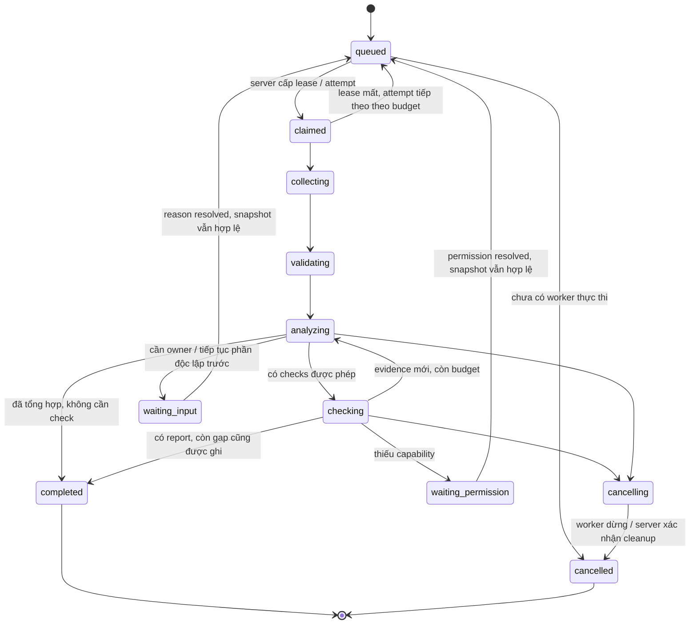

# P1 — Contract dữ liệu và giao tiếp v1 (lịch sử)

**Đã thay bởi [v2](DATA-CONTRACT.md).** Nội dung dưới là thiết kế tại `872c498`, còn các lỗi được phát hiện trong audit; các lệnh validator v1 chỉ áp dụng khi checkout commit lịch sử, validator hiện hành từ chối v1. Không dùng tài liệu này làm gate P1 đã vá.

Ngày 05/11/2026, nền `e87e15b`. Trạng thái: **bản thiết kế contract v1 có schema và kiểm tra specimen offline**, chưa có product runtime/server/API/worker/desktop. Phù hợp [quyết định sản phẩm](PRODUCT-DECISIONS.md), [scope](FRAMEWORK-SCOPE.md) và plan P1. Semantics sufficiency/risk chi tiết thuộc P2; topology/SDK/transport/storage thuộc P3.

## 1. Phạm vi và nguyên tắc

Hai intake `repo_task` và `handoff_bundle` cùng đi về handoff chuẩn. Desktop Windows, plugin/host agent và server/worker dùng cùng IDs, project/version, revision, commands và reports. Agent local hoặc OpenAI/Anthropic adapter được chọn theo project; không nhúng SDK của provider vào core contract.

Contract tách ba trạng thái: **execution lifecycle**, **verification theo scope**, **human decision**. `run.state=completed` nghĩa xử lý đã kết thúc và có report; report vẫn có thể `incomplete` hoặc `failed`. Test fail không nhất thiết là lỗi execution của workflow; một worker crash không chứng minh sản phẩm vi phạm requirement.

Artifact trong repo này chỉ synthetic. Các ví dụ contract là **specimen do tác giả soạn**, không phải execution/QC/model response thật. Chúng không truy repo, gọi API, chạy container hoặc cấp quyền. Dependency Python dùng kiểm schema không phải lựa chọn ngôn ngữ/runtime cho sản phẩm.

## 2. Định dạng và lớp kiểm tra

[JSON Schema v1](../schemas/qa-contract-v1.schema.json) dùng Draft 2020-12, `$defs`, object strict `additionalProperties=false`. [Specimen bundles](../examples/contracts/v1/README.md) đóng gói các resource liên quan để kiểm tham chiếu offline. Envelope `contractVersion=1.0.0`, `classification=synthetic-only`, `specimenNotice` là định dạng bundle kiểm thiết kế, **không phải HTTP/MCP envelope production**. Các `$defs` là resource shapes dự kiến được reuse khi P3 chọn transport.

| Lớp | Kiểm gì | Hiện trạng |
|---|---|---|
| Shape | Field, type, enum, required, lengths, timestamp, không nhận field tùy ý | JSON Schema + format checker trong công cụ P1 |
| Reference consistency | ID trùng, foreign reference/project, AC mapping, revision/version, summary tự mâu thuẫn | Công cụ [validate_contracts.py](../tools/validate_contracts.py) |
| QA reasoning/sufficiency | Evidence có thực chứng minh expected behavior, risk, domain finding/constraint policy | **Chưa có engine**; P2 thiết kế, agent reasoning phải có nguồn |
| Runtime enforcement | Authentication, authorization, secret lookup, file containment/symlink, image/runtime checks, lease expiry, idempotency atomicity | **Chưa hiện thực**; contract hành vi bên dưới là yêu cầu P3/P4 |

Schema đúng không nghĩa claim đúng, permission hợp lệ, command được phép thực thi hoặc report được phê duyệt. Không dùng validator specimen như security boundary của server.

## 3. Identity, version và reference

- ID opaque, case-sensitive, tối đa 96 ký tự, bắt đầu chữ; unique trong loại resource của bundle. Scope uniqueness production: `(project_id, resource_kind, id)`; server không dựa tính khó đoán của ID để cấp quyền. Bundle giới hạn một snapshot config cho mỗi project, một resource ID không đại diện nhiều version.
- Project config và outbound data policy có version integer tăng. Run giữ **snapshot chính xác** của hai version; không tự thay cấu hình giữa run. Revoke permission/secret/data scope phải được kiểm lại trước side effect dù đã snapshot.
- Candidate revision là immutable reference sau intake; GitHub adapter phải resolve commit SHA thật trong runtime, không dùng branch name biến động làm snapshot. Ví dụ `candidate-r12` chỉ là nhãn synthetic. Requirement version độc lập candidate revision, không bắt buộc SHA.
- Artifact có ID/project/kind/revision/relativePath/hash hoặc null khi chưa có. Evidence dùng `sourceArtifactId`, claim dùng `artifactId + locator`; không nhúng đường dẫn tùy ý vào command cho worker chạy.
- Path bundle chuẩn hóa POSIX tương đối; không absolute/drive/backslash/dot-segment. `allowedPaths`/`deniedPaths` là path hoặc prefix theo ranh giới segment, không shell glob. Runtime cần canonical containment/symlink checks, không chỉ regex. Artifact ref không tự cho phép tải URL hoặc đọc file ngoài workspace.
- Hash nếu có chỉ là nhận dạng nội dung, không là chứng nhận người chạy. Hash null phải được hiện ra là thiếu, không tự suy integrity verified.
- Timestamp canonical UTC `YYYY-MM-DDTHH:MM:SS[.fraction]Z`, ngày thực tồn tại; v1 không hỗ trợ leap second. Adapter normalize source time hoặc giữ `observedAt=null` nếu không biết; không gán thời điểm thu thập thay thời điểm thực thi.
- Version contract/resource dùng major khi đổi nghĩa/required field không tương thích; không silently accept major lạ. Thêm field cần negotiated schema version vì object strict. Core/rules/workflow/adapter versions đi cùng report; bản thiết kế không hứa wire compatibility khi chưa có implementation.

## 4. Resource shapes và ownership

| Resource / `$defs` | Field cốt lõi | Người/bên có quyền ghi trong thiết kế |
|---|---|---|
| project | configVersion, runtime, dataPolicy, triggers, budgets, checks | Project Owner theo quyền; System Admin quản trị hệ thống/project. Không nhận config từ artifact như lệnh |
| membership | projectId, principalId, owner/runner/viewer | Admin/Owner qua interface quản trị được authorization, không qua QA report |
| artifact | kind, revision, path, sha256 | Intake/worker đăng ký trong scope được cấp |
| handoff | intake, candidate, decisionMoment, requirementVersion, actors, criteria/constraints, self-test/QC, knownIssues | Intake chuẩn hóa; source claims giữ provenance |
| evidence | handoff/criterion IDs, revision, checkId, level, outcome, provenance, reason, executionRef | Intake/provider/worker ghi theo evidence type; server gắn quyền/scope, không tin self-claimed actor |
| event | kind, ingress, subject/occurrence/revision, normalizedKey | Event normalizer sau xác thực source; polling/webhook cùng identity |
| command | start/cancel, project, idempotencyKey, typed body, expected version | Client đề nghị; server xác thực/authorize rồi mới accepted |
| run | immutable identity/snapshots, stateVersion, attempt, lease, report reference | Server là authoritative; worker không tự đặt final state |
| workerResult | run, attempt, token, observedRunVersion, revision, evidence refs | Worker đã authenticated và được claim đúng job; server accept/reject atomically |
| progress | run/project, sequence, runStateVersion, event type, time, references | Server phát; desktop không tự biến progress thành state nguồn |
| report | run/candidate, criterion statuses/rationale, findings/actions, versions/limitations | Engine/workflow tạo snapshot, không mutate bản cũ; không cấp approval |

Schema bundle có collections tương ứng. Principal identities, credentials/password/token, secret bodies và network credentials **không nằm trong QA bundle**. `actorRef` trong evidence là provenance claim, không phải authenticated principal. `System Admin` là vai trò cấp hệ thống, không là membership do client tự khai. Credential lookup/authorization thuộc server.

### Project config

`runtime` là union: `agent_local` có `connectorRef`; `model_api` có `provider=openai|anthropic`, model ID và `credentialRef`. Không được cùng lúc ngầm fallback sang provider khác ngoài cấu hình. Secrets là opaque references đến secret store server; raw key/password không được đưa vào config export/report/progress.

`repository` dẫn GitHub repository/credential references đã đăng ký server, không nhận clone URL arbitrary từ model. `requirementConflictPolicy` cố định hỏi owner và tiếp phần độc lập; `editPolicy` cấm sửa source/test ở v1.

`dataPolicy` có version, allowed artifact kinds/paths, denied paths và allowed providers. Deny thắng allow; thiếu policy/provider/path match thì outbound phần đó bị chặn, không gửi trước rồi ghi warning. Policy áp dụng cả đường model API và connector agent có thể gửi dữ liệu ra ngoài; chưa có khả năng enforce connector thì không coi nó policy-compliant. Model output là dữ liệu có nguồn, không phải authority thực thi command.

`budgets` khai run timeout, attempts/concurrent runs và token limits; **các số trong specimen không phải giá trị mặc định được người dùng duyệt**. Khi dùng sản phẩm, Owner cấu hình theo project; server kiểm quota tài nguyên thực tế và provider accounting. P3 sẽ chọn cách quan sát token/cost và fail-closed khi không đo/giới hạn được; không hứa hard monetary cap chỉ từ token budget.

`checks` có check ID, config artifact, image pinned digest, timeout và network policy reference. Không nhận raw shell/privileged flags trong lệnh start từ client/model. Cấu hình môi trường do project cung cấp nhưng chỉ chạy khi thỏa capability/trust policy server; không mount host secrets hoặc cho Docker socket/privileged tùy ý. Contract không tự chứng minh container an toàn.

### Handoff / requirement

AC có expected, mandatory, claims, clarification `clear|conflict|ambiguous`, ownerRole. Khi conflict/ambiguous chưa được giải đáp, trạng thái kết luận phải unverified; tiếp tục AC độc lập. Không tự chọn tài liệu/PR thắng. Owner clarification là quyết định có nguồn/version; nếu đổi expected/candidate thì materialize handoff snapshot/run mới, không đổi đầu vào run cũ.

Luôn khai đúng một stage record developer_self_test và một qc, kể cả `unknown`/`not_performed`; `provided` phải dẫn evidence. Không có QC không tự là defect code; policy của decision moment mới quyết định gap nào bắt buộc. Actors có thể null khi chưa có người nhận, không bịa QC độc lập.

Constraints giữ mandatory/state/source, ví dụ domain review P-05 pending có thể làm verification incomplete dù behavior AC pass. Known issue có severity/state/source; `low` không tự là miễn xử lý hoặc blocker. Risk acceptance/human decision cần nguồn người có quyền, chưa có command auto-approve.

### Evidence / report

Outcome: `pass|fail|error|skipped|blocked|not_run|unknown`. Non-pass phải có reason. Level tách unit/integration/source_review/qc_scenario. Provenance: `authored_mock|execution|reported|source_reasoning`. Execution claim phải có observedAt + executionRef; authored_mock không được claim executionRef. Reference tồn tại chưa chứng minh nội dung log/actor đúng: P4 cần nhận và kiểm manifest/execution record thực.

Evidence cũ được giữ như context, không phải input invalid chỉ vì stale. Report không được cite evidence sai revision như verified cho candidate. Schema/checker không suy tất cả pass → verified. AssessmentKind `record_only|execution_supported|source_reasoning|insufficient` và limitations giữ mức kết luận; `insufficient` không đi với verified/failed. Record-only không được trình bày như thực thi kiểm chứng hệ thống thật.

Report phải account mọi AC, deduplicate IDs, dẫn sources. `hasUnverifiedMandatory` chỉ đếm AC mandatory unverified; constraint pending kiểm riêng. Self-consistency v1: có AC failed → tổng failed, vẫn giữ flag phần chưa kiểm chứng; nếu không failed mà còn mandatory unverified/constraint pending → incomplete; còn lại complete trong scope. Đây là kiểm summary theo status **đã được cung cấp**, chưa chứng minh status đúng; điều kiện N/A/sufficiency/defect confirmation chi tiết ở P2.

Findings có category, verdict và rationale; duplicateOf dẫn finding khác, không tự đếm thành issue mới. Action có ownerRole, assignee hoặc null, doneWhen/state; thiếu người nhận không được đổi thành done. `humanDecision` output luôn pending trong v1: review/approval là record riêng được người có quyền thực hiện ngoài bộ command QA đầu tiên, không suy từ role Runner hoặc report complete.

## 5. Authentication và permission contract

Server authenticates bằng tài khoản nội bộ; password/token/session protocol, hashing/key storage/expiry và SSO extension được chọn ở P3. Chưa có auth implementation. Worker identity/service principal tách khỏi human session; command/event/body không được tự claim role. Auth failure khác project denied, nhưng response không tiết lộ project/secret ngoài quyền.

| Hành động | System Admin | Project Owner | Runner | Viewer |
|---|---|---|---|---|
| Tài khoản nội bộ, worker enrollment, server settings | Có | Không | Không | Không |
| Xem project/run/report theo project được cấp | Có theo policy quản trị | Có | Có | Có |
| Config runtime/data policy/checks/events và secret reference | Có | Có | Không | Không |
| Gán Runner/Viewer, quản lý project membership | Có; cấp Owner/transfer theo policy quản trị | Có trong project; không tự cấp System Admin | Không | Không |
| Start QA trong project | Có | Có | Có | Không |
| Cancel run trong project | Có | Có | Chỉ run do mình khởi tạo | Không |
| Reveal raw secret qua QA UI/report/export | Không | Không | Không | Không |
| Ghi human approval tự động từ run | Không | Không | Không | Không |

Đây là permission matrix thiết kế trong scope fixed roles, không phải quyền đã cấp trong repo. Quyền Owner transfer, account recovery và emergency admin access cần ADR/audit ở P3. Assignment/revoke phải kiểm server ở **mỗi command, đọc stream/report/artifact và side effect**. Snapshot config không giữ quyền cũ sau revoke. Webhook/poller chạy dưới project integration principal, chỉ khởi động được những trigger đã bật.

## 6. Commands, queries và response boundary

Schema v1 serialize hai command thay đổi run; mỗi command có projectId, idempotencyKey và typed body, **không có actor/role/password**. Server lấy principal từ kênh authenticated. `start_run`: handoffId, exact candidateRevision, expectedProjectVersion. `cancel_run`: runId, expectedRunVersion.

Idempotency scope `(project, authenticated principal hoặc integration identity, key)`: cùng normalized type/body thì trả kết quả cũ, khác body → `IDEMPOTENCY_CONFLICT`; compare-and-set version không khớp → `VERSION_CONFLICT`. Checker specimen chỉ so body trong bundle, **không có principal authentication/atomic database**. Start accepted chỉ nghĩa đã enqueue, không nghĩa test/QA pass. Server trả resource/run ID và stateVersion; transport status codes thuộc P3.

Read interfaces thiết kế: list projects người dùng có quyền; get project snapshot/capabilities; get run/report/artifact reference; subscribe progress bằng `(projectId, runId, afterSequence)` hoặc get snapshot khi cursor đã hết hạn. Error envelope dự kiến: code, safe message, requestId, retryable, field paths khi được phép; không echo arbitrary request body/secret/raw provider errors. JSON Schema bundle chưa là OpenAPI/MCP spec đầy đủ cho queries/auth/admin; P3 cần map resource shapes sang transport mà không đổi domain contract ngầm.

Resume không mutate terminal run. Waiting run có thể được requeue sau khi scope/identity/candidate còn hợp lệ và reason đã giải quyết; material change tạo run/handoff mới có audit link. Command/API cụ thể cho configuration/membership/clarification sẽ thiết kế ở P3, không dùng raw model instructions để thay API quản trị.

## 7. Event identity và polling/webhook

Các event domain được chọn: `dev_handoff`, `qc_handoff`, `pr_ready`. Ingress `internal|polling|webhook`; GitHub adapter phải map sự kiện provider được xác thực sang domain event. Hành động GitHub cụ thể/subscription permissions chưa được chốt bằng API code tại P1.

Identity canonical: `projectId|kind|subjectRef|occurrenceRef|candidateRevision`; cấm delimiter trong từng thành phần của v1. `externalDeliveryId` dùng audit/replay transport, **không là identity domain** vì polling và webhook không chung delivery ID. Một transition “ready lần nữa” trên cùng commit có occurrence khác; không gộp mọi event cùng candidate vĩnh viễn.

Server phải lưu atomic event receipt/normalization/run-create: delivery trùng cùng occurrence không tạo run kép; polling cursor chỉ advance sau persist, webhook chỉ ack theo durability policy. Chính sách coalescing khi candidate đổi không sửa run đang có; đánh dấu superseded/cancel hoặc tạo run mới theo P2/P3. Bundle `events` là normalized accepted identities (unique), không là raw receipt stream. Không hứa exactly-once test execution: crash/retry vẫn cần idempotent side effects và fencing.

Polling có thể không quan sát được transition bị bỏ qua giữa hai lần đọc nếu provider không cung cấp lịch sử; adapter phải công bố khả năng đó, không bịa occurrence. P3 cần chiến lược catch-up/cursor/reconciliation dựa trên API GitHub chính thức. Webhook cần xác minh signature/delivery/repo/project và giới hạn replay; chưa có listener hoặc public endpoint triển khai.

## 8. Run lifecycle, worker và disconnect



Sơ đồ là đường phổ biến; transition table đầy đủ dưới đây bổ sung lỗi/cancel cho mọi phase, không bắt UI đoán từ sơ đồ.

| From | To được phép | Điều kiện/authority |
|---|---|---|
| queued | claimed, cancelled, failed | Server claim hợp lệ, cancel trước thực thi hoặc config không thể xử lý |
| claimed/collecting/validating/analyzing/checking | Phase tiếp theo hợp lệ, waiting_input, waiting_permission, cancelling, failed | Server nhận result/current version; không nhảy qua validation bắt buộc |
| analyzing/checking | completed | Đã có report, phần unresolved được thể hiện; report incomplete không bắt giả làm run failed |
| claimed/collecting/validating/analyzing/checking | queued | Lease mất/retry hợp lệ, old attempt bị fenced và cleanup reconcile trước check tiếp |
| waiting_input/waiting_permission | queued, cancelled, failed | Reason resolved và snapshot/policy hợp lệ; hoặc hết budget/cancel |
| cancelling | cancelled, failed | Xác nhận stop/cleanup; cleanup failure không giả báo cancellation sạch |
| completed/failed/cancelled | Không đổi | Terminal immutable; retry/revision mới là run mới, không rewrite evidence/report |

`initiator` do server gắn từ principal đã xác thực hoặc integration identity, không cho client tự claim để hủy run người khác. Owner/Admin có thể cancel run trong project theo policy quản trị; Runner chỉ cancel run của chính mình.

`stateVersion` tăng bằng server CAS; attempts/lease token tăng theo claim, không reuse token. Worker result mang run/project/attempt/token/observedRunVersion/candidate; server kiểm worker identity, token, expiry bằng server time và run phase. Result đến muộn hoặc từ attempt cũ bị từ chối/quarantine, không ghi đè attempt hiện tại. Offline checker chỉ kiểm match với snapshot đã cho, không kiểm clock/identity hoặc claim atomically.

Run giữ execution budgets riêng với token budget. Waiting clarification không chặn AC độc lập; nếu đã làm hết phần còn làm được, có thể completed với report incomplete thay vì giữ lease vô hạn. Khi waiting, lease phải được release theo thiết kế runtime; worker không được giữ container/secret không cần thiết. Cancel là request đến server, không chỉ đổi UI; desktop đóng không là cancel, worker vẫn chạy.

Progress là server event theo run: sequence tăng, runStateVersion, type `run_state|check_completed|report_ready`, time, IDs tham chiếu. Không stream raw secret/artifact lớn. Client reconnect lấy snapshot và replay sau cursor; duplicate event ignore theo sequence; gap/retention expired yêu cầu snapshot. Progress không tự là state source of truth.

## 9. Container và capability contract

Worker claim project/run chỉ tạo container từ image/config hợp lệ, checkout candidate chính xác vào workspace riêng. Repo source được dùng đọc/test, không sửa source/test gốc; build/cache/output chỉ ở path run đã định. Nếu check bắt buộc sửa input hoặc cần quyền/network ngoài scope, blocked hoặc request capability, không tự mở quyền.

Project capability cần refs cho network policy/secrets/toolchain/budget và revocable authorization. Network/data egress test container khác model outbound policy; cả hai phải được enforce. Không gắn secrets provider vào container test nếu check không cần. Image/secret refs trong schema chỉ có shape, không phải approval cho image/tool. P3 phải chọn container engine/worker OS compatibility, resource ceilings, trusted/untrusted config handling và orphan/process cleanup.

Không có API “shell arbitrary” cho model/UI, không expose Docker socket vào test container. Read-only QA không đồng nghĩa mọi test command không có tác dụng phụ; executor phải đặt boundary/mount/output và ghi phạm vi check. Không dùng plugin quyền host để bypass project/server policy.

## 10. Errors và kiểm tra specimen

Nhóm lỗi P1: `E_SCHEMA`, `E_INPUT`, `E_REFERENCE`, `E_REFERENCE_TYPE`, `E_PROJECT_BOUNDARY`, `E_DUPLICATE_ID`, `E_PATH`, `E_VERSION`, `E_REVISION`, `E_PROVENANCE`, `E_OUTCOME_REASON`, `E_STAGE_RECORD`, `E_DATA_POLICY`, `E_EVENT_KEY`, `E_IDEMPOTENCY`, `E_REPORT_STALE`, `E_CLARIFICATION`, `E_ASSESSMENT`, `E_REPORT_SUMMARY`, `E_DUPLICATE_FINDING`, `E_RUN_STATE`, `E_LEASE`, `E_FENCING`. Path/format errors là contract errors, không defect behavior; check error/blocked ở evidence là dữ liệu hợp lệ, không tự là malformed contract.

Từ root repo, dùng Python 3.10+ có [dependency kiểm contract](../tools/requirements-contracts.txt):

```text
py -3 -X utf8 -B tools/validate_contracts.py examples/contracts/v1/valid-handoff.json
py -3 -X utf8 -B tools/test_contracts.py -v
```

CLI exit 0 valid; 1 schema/reference inconsistency; 2 unreadable/malformed UTF-8 JSON. Không ghi output report hoặc sửa input, không network/API/subprocess project. Test harness dùng subprocess chỉ để kiểm CLI trên JSON.

Đã kiểm 3 bundles hợp lệ, 39 negative scenarios và CLI valid/invalid/malformed/missing. Một failure ban đầu phát hiện dependency format tùy chọn không kiểm timestamp; đã sửa checker UTC/calendar rõ và có regression cho ngày không tồn tại. `unittest` hiển thị 3 test methods có subtests; không gọi 3 method là chỉ 3 tình huống hoặc các kiểm tra này là QA engine đã hoàn tất.

Nguồn kỹ thuật: [JSON Schema 2020-12](https://json-schema.org/draft/2020-12/json-schema-core), [jsonschema validator/format checking](https://python-jsonschema.readthedocs.io/en/stable/validate/). Đây là lựa chọn định dạng/tooling thiết kế P1, không chốt runtime/SDK/database của sản phẩm.

## 11. Gate P1 và phần tiếp theo

P1 v1 có resource shapes/ownership, auth permission matrix, event identity, commands/progress/worker-result, lifecycle, provenance và valid/invalid examples kiểm được. **Không coi đây là protocol production hoàn chỉnh**: admin/auth/query transport, atomic persistence, secret/container/network enforcement và provider/GitHub bindings chưa có code, sẽ phải được map/test ở P3/P4.

Bước P2 là bảng quyết định sufficiency/status/constraint/finding/action và expected scenarios, không bắt đầu triển khai desktop/server từ schema. Nếu P2 phát hiện field thiếu, tăng contract version và giữ specimen/test lịch sử; không sửa âm thầm nghĩa v1 đã được dùng.
