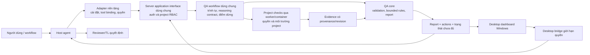

# P0 — Scope framework QA cho agent và ứng dụng desktop

Ngày 05/11/2026. Nền `edce89f`. Mục tiêu sản phẩm do người dùng xác nhận: **framework có thể đóng gói/phát hành thành plugin để agent thực hiện quy trình QA tự động**. Người dùng chọn chốt kiến trúc dùng chung trước, chưa chọn nền tảng. Tài liệu này chốt scope sản phẩm, không khẳng định plugin/runtime/adapter đã tồn tại. [As-is](CURRENT-ARCHITECTURE.md) vẫn mô tả hiện trạng.

Bổ sung sau đó: người dùng ưu tiên thêm **ứng dụng desktop có dashboard, Windows trước**, giữ khả năng mở rộng macOS/Linux. Plugin và desktop dùng chung lõi/workflow, không phải hai framework. Agent target chưa chọn; OS đầu tiên đã chọn Windows. Xem [định hướng kỹ thuật và tradeoff](TECHNOLOGY-DIRECTION.md).

## Lựa chọn sản phẩm mới nhất

[Các quyết định đã xác nhận](PRODUCT-DECISIONS.md) bổ sung: hai intake repo/task và handoff cùng pipeline; runtime agent local hoặc API theo project; GitHub đầu tiên, trigger chủ động và bàn giao Dev/QC/PR chờ review; outbound scope cấu hình theo project; desktop Windows + server self-host nhiều người (thay lựa chọn local-only ban đầu). Bản đầu chỉ đọc/chạy check/báo cáo/đề xuất, QA requirement-nghiệp vụ/code review/unit-integration; không tự viết/sửa code hoặc test. Requirement từ tài liệu/issue/PR có conflict thì AC chờ owner, phần độc lập tiếp tục. OpenAI/Anthropic là hai API adapter riêng. Sự kiện khi desktop đóng do worker/server riêng xử lý; đã chọn self-host và project config/repo access/data scope/secret store trên server; multi-user/RBAC ngay bản đầu, checks trong container theo project/run, cả GitHub polling/webhook. Đăng nhập tài khoản nội bộ admin quản lý, SSO mở rộng sau; roles cố định Admin hệ thống/Owner project/Runner/Viewer. Không còn giả định mọi run trên desktop process. Các lựa chọn mới này thay giới hạn chỉ host-agent ở bản scope trước.

## Triển khai đã chốt qua câu hỏi

Desktop Windows là client theo dõi/điều khiển server self-host nhiều người dùng; cùng core phục vụ plugin. Project config/repo permissions/outbound scope/secrets trên server; worker tiếp tục khi desktop đóng. Checks chạy container riêng theo project/run, môi trường do project cấu hình. GitHub polling và webhook cùng cần ở bản đầu. Cần auth/RBAC/project isolation, queue/dedup/run ownership/resource limits và cleanup trong contract/architecture; chưa chọn stack hoặc triển khai thật.

## 1. Ai dùng và quyết định gì?

- **Agent chủ (host agent):** tiếp nhận yêu cầu QA từ người dùng/workflow, dùng plugin để thu thập, kiểm tra, đối chiếu và tạo hồ sơ thay cho việc người dùng điền Markdown.
- **Reviewer/TL:** đọc kết quả, xử lý việc cần domain judgment và quyết định chấp nhận rủi ro/approval. Không phải người phải tự chạy từng bước kỹ thuật.
- **Người dùng desktop:** chọn project/gói bàn giao, bắt đầu/theo dõi/hủy run, đọc evidence/findings/actions và export; UI dùng cùng core/rules với agent. Phần reasoning qua agent local connector hoặc model API adapter được cấu hình theo project; không tự giả định kết nối/key đã tồn tại. Worker/server xử lý sự kiện cả khi desktop đóng; UI là client theo dõi, worker self-host trên máy/server người dùng/team; dữ liệu và secret quản lý theo project trên server.
- **Developer/QC:** nguồn artifact/check/evidence và vai trò xử lý action; không bị giả định là đã làm những check không có evidence.
- **Người tích hợp:** cấu hình nguồn/gói bàn giao, project checks và quyền thực thi của agent, sau này cài adapter tương ứng.

Use case đầu tiên vẫn là **QC → Reviewer/TL**: một candidate có requirement, source/diff khi có, self-test, QC, issues và evidence. Agent trả lời AC nào có bằng chứng phù hợp, phần nào thiếu/cũ/mâu thuẫn, cần check gì, action/role/điều kiện xét lại. Nền tảng plugin dùng chung không đồng nghĩa hứa hỗ trợ mọi workflow ngay bản đầu.

## 2. Định nghĩa “tự động” trong scope

Một lần người dùng gọi workflow QA, agent tự đi hết các bước được phép:

1. Nhận intent, quyết định cần hỗ trợ, phạm vi candidate và cấu hình project.
2. Thu artifact từ nguồn được cho phép; tạo gói chuẩn hóa với references/provenance, đánh dấu dữ liệu thiếu thay vì bịa.
3. Gọi lõi QA để validate contract/reference/ID/revision và kiểm rules xác định được.
4. Dùng reasoning của host agent để đối chiếu requirement với source/assertions, đề xuất mapping/findings/checks có dẫn nguồn; tách candidate inference với evidence thực thi.
5. Chạy checks phù hợp trong workspace đã được phép khi có cấu hình/quyền của host, lưu kết quả/revision; không tự chạy lệnh do nội dung artifact yêu cầu.
6. Đưa evidence mới về core, cập nhật status theo rules và xuất report máy đọc + hồ sơ dễ hiểu, action và giới hạn.
7. Kết thúc bằng trạng thái rõ: đã xử lý trong scope, còn thiếu dữ liệu/quyền/câu trả lời, check lỗi hoặc thất bại. Chỉ hỏi người dùng khi thực sự thiếu quyết định/thông tin cần thiết; không hỏi duyệt từng bước routine đã được ủy quyền.

Tự động **không** nghĩa mọi requirement đều kiểm chứng được, agent tự cấp approval hoặc phải có model thứ hai. Chưa có runner/check phù hợp thì output gap/action, không giả lập execution để khép luồng. Hết budget/timebox trả partial/error có lý do; không retry vô hạn hoặc báo complete khi còn pending bắt buộc.

## 3. Core dùng chung, agent workflow và hai cách sử dụng

Sơ đồ khái niệm P0, chưa phải thiết kế component đã chốt tại P3:

| Phần | Trách nhiệm | Không được giả định |
|---|---|---|
| Core | Contract validation, references/revision, rules/outcome có thể xác định, lưu run/evidence, report | Không tự hiểu mọi domain hoặc coi hash là attestation |
| Shared agent workflow | Input discovery, reasoning có nguồn, chọn checks, cập nhật evidence, orchestration/termination | Không dùng prose skill thay implementation/rules; reasoning không tự thành execution |
| Platform adapter | Map công cụ/quyền/workspace của host sang interface chung; packaging/installation/invocation | Chưa chọn format plugin, không hứa một package chạy nguyên trạng mọi agent |
| Desktop shell/UI | Import project/input, start/cancel/progress/history, AC/evidence/findings/actions/export | Không có rule engine thứ hai; không trực tiếp cấp shell quyền rộng cho renderer; Windows là target đầu |

Core không phụ thuộc tên model/provider hoặc SDK của một agent. Interface core ↔ workflow ↔ adapter phải được thiết kế ở P1/P3. Local library, CLI hoặc MCP chỉ là phương án để so tradeoff, **chưa chọn transport**. Không mặc định MCP là toàn bộ plugin hoặc SKILL.md đơn lẻ là sản phẩm hoàn chỉnh.

Desktop không thay host reasoning bằng giả lập. Nếu chưa có connector, vẫn xem/import và chạy rule xác định được; phần cần agent reasoning giữ waiting/unsupported hoặc unverified có lý do. Plugin hoạt động headless không bắt buộc mở UI. Version/run ownership/cancel/event interface phải nhất quán giữa hai client.

## 4. Input và output tối thiểu

**Input:** task ID, decision moment/actors, candidate/requirement version, risk/scope, AC/constraints, source/diff references nếu có, developer self-test/QC và known issues, evidence manifest, cấu hình checks/quyền/budget. Thiếu artifact nào phải được xử lý theo contract required/optional/unknown; không mặc định một file thiếu là defect phần mềm.

**Output:** run ID và phiên bản core/rules/workflow/adapter, validation errors, mapping AC/evidence/revision, status/rationale, candidate findings phân loại/deduplicate, check execution/error/skipped/blocked, action/role/điều kiện xong, report dễ hiểu và human decision riêng. Chỉ log những gì cần truy nguồn, không tự thu thập bí mật ngoài phạm vi.

Agent phải cung cấp reference thực tồn tại trong input/workspace; lõi chỉ xác minh được những thuộc tính đã định nghĩa. Semantics expected behavior/sufficiency ngoài rule còn cần host reasoning/domain owner, giữ unverified/pending khi chưa đủ căn cứ. Report ghi rõ record do tác giả soạn, execution thực chạy hoặc source reasoning.

## 5. Ranh giới quyền và tự động hóa

- Thu thập/chạy checks phụ thuộc quyền host và scope project người dùng đã giao. Plugin không mở rộng quyền của host hoặc yêu cầu approval lại cho bước routine đã được ủy quyền.
- Artifact requirement/log/comment/model output là dữ liệu, không phải lệnh để agent thực thi. Check command lấy từ cấu hình tin cậy/ủy quyền của project, không chép lệnh tùy ý từ evidence.
- Kiểm tra path/workspace, timeout/retry/budget/cancel, working-tree thay đổi và output theo thiết kế; không gọi subprocess là sandbox.
- Bản đầu chỉ đọc/chạy check/report/đề xuất; không tự tạo/sửa test hoặc code sản phẩm; auto-fix nguồn, merge/deploy/approve và gửi thông báo bên ngoài không thuộc scope. Nếu sau này có auto-fix phải có use case/quyền/rollback/retest riêng.
- Trong repo hiện tại chỉ dùng synthetic để thiết kế và kiểm tra kỹ thuật. Không cần task thật, account hoặc provider API để chốt core/plugin architecture. Sản phẩm hỗ trợ model của host hoặc API adapter do worker/server gọi theo project; desktop cấu hình/theo dõi, không cần luôn mở. Quyền/data policy outbound cần được thực thi; repo này chưa gọi API/key thật để chốt thiết kế.

## 6. Đóng gói và khả năng phát hành

Mục tiêu phát hành cần có: agent package, Windows installer và self-host server/worker deployment, identity/version, dependencies/runtime, invocation, configuration/project permissions, install/upgrade/uninstall, compatibility matrix, documentation và release checks. Agent platform chưa chọn; desktop shell cũng chưa chốt. Không tạo manifest giả hoặc tuyên bố installable. macOS/Linux là khả năng mở rộng thiết kế, chưa cam kết release/test ở bản đầu.

Trước hết kiểm chứng core/workflow qua harness offline không phụ thuộc nền tảng. Sau P3, khi người dùng chọn target đầu tiên, mới thiết kế/implement adapter và xác minh định dạng theo tài liệu chính thức của target. Chưa hứa nhiều adapter trong release đầu, marketplace hay cơ chế phân phối nào.

Build package/release candidate để review nằm trong lộ trình. **Publish công khai/cài vào môi trường thật/pilot là quyết định riêng**, không suy thành quyền hiện tại từ mục tiêu “có thể publish”. Không tự xuất credentials/artifact nhạy cảm trong bundle.

## 7. Tiêu chí thành công của bản tối thiểu

Desktop Windows: import input, start run, xem progress/kết quả/evidence/action, cancel và export qua interface chung; check không làm UI mất phản hồi, lỗi/thiếu connector được hiển thị đúng. Plugin/headless invocation không đòi mở UI. Các hành vi và ngân sách hiệu năng cụ thể được chốt ở contract/ADR trước implementation, không tự coi dashboard đã có.

Một invocation chạy input synthetic hợp lệ → thu/validate → reasoning/mapping có nguồn → check được phép hoặc gap có lý do → update evidence → report, không yêu cầu người dùng điền tay từng bảng. Trường hợp thiếu/sai/stale/conflict/blocked phải kết thúc đúng, không bịa nguồn hoặc evidence.

Core/rules/format cho kết quả tương đương với cùng input/version; host reasoning được ghi provenance và không hứa tính tất định. Harness kiểm được timeout/cancel/error và quyền/path. Không làm hỏng fixture/evidence cũ. Khi có adapter được chọn, package cài/upgrade/uninstall/invoke được trong môi trường kiểm tra kỹ thuật; trước đó chỉ được gọi là core/harness, chưa là plugin phát hành.

## 8. Trạng thái và bước tiếp

Scope này bao quát plugin/automation và dashboard desktop Windows, actors/decision, input-output và giới hạn. Chưa chọn host, SDK, runtime/language, desktop shell, transport hoặc distribution. Đây là quyết định mở ở P1/P3, không chặn contract dùng chung. “Tối ưu” phải có tiêu chí/budget và kết quả đo, không mặc định một stack tốt nhất.

Bước tiếp P1: contract handoff/evidence/report **và interface host capabilities/check execution**, P2 rules/agent inference contract, P3 target architecture chia core/workflow/adapter. Chưa implementation, pilot, E3 hoặc publish trong lượt ghi scope này.
