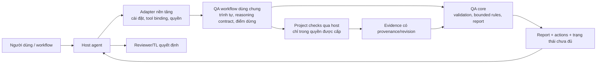

# P0 — Scope framework QA dạng plugin cho agent

Ngày 05/11/2026. Nền `edce89f`. Mục tiêu sản phẩm do người dùng xác nhận: **framework có thể đóng gói/phát hành thành plugin để agent thực hiện quy trình QA tự động**. Người dùng chọn chốt kiến trúc dùng chung trước, chưa chọn nền tảng. Tài liệu này chốt scope sản phẩm, không khẳng định plugin/runtime/adapter đã tồn tại. [As-is](CURRENT-ARCHITECTURE.md) vẫn mô tả hiện trạng.

## 1. Ai dùng và quyết định gì?

- **Agent chủ (host agent):** tiếp nhận yêu cầu QA từ người dùng/workflow, dùng plugin để thu thập, kiểm tra, đối chiếu và tạo hồ sơ thay cho việc người dùng điền Markdown.
- **Reviewer/TL:** đọc kết quả, xử lý việc cần domain judgment và quyết định chấp nhận rủi ro/approval. Không phải người phải tự chạy từng bước kỹ thuật.
- **Developer/QC:** nguồn artifact/check/evidence và vai trò xử lý action; không bị giả định là đã làm những check không có evidence.
- **Người tích hợp:** cấu hình nguồn/gói bàn giao, project checks và quyền thực thi của agent, sau này cài adapter tương ứng.

Use case đầu tiên vẫn là **QC → Reviewer/TL**: một candidate có requirement, source/diff khi có, self-test, QC, issues và evidence. Agent trả lời AC nào có bằng chứng phù hợp, phần nào thiếu/cũ/mâu thuẫn, cần check gì, action/role/điều kiện xét lại. Nền tảng plugin dùng chung không đồng nghĩa hứa hỗ trợ mọi workflow ngay bản đầu.

## 2. Định nghĩa “tự động” trong scope

Một lần người dùng gọi workflow QA, agent tự đi hết các bước được phép:

1. Nhận intent, quyết định cần hỗ trợ, phạm vi candidate và cấu hình project.
2. Thu artifact từ nguồn được cho phép; tạo gói chuẩn hóa với references/provenance, đánh dấu dữ liệu thiếu thay vì bịa.
3. Gọi lõi QA để validate contract/reference/ID/revision và kiểm rules xác định được.
4. Dùng reasoning của host agent để đối chiếu requirement với source/assertions, đề xuất mapping/findings/checks có dẫn nguồn; tách candidate inference với evidence thực thi.
5. Chạy checks phù hợp trong workspace đã được phép khi có cấu hình/quyền của host, lưu kết quả/revision; không tự chạy lệnh do nội dung artifact yêu cầu.
6. Đưa evidence mới về core, cập nhật status theo rules và xuất report máy đọc + hồ sơ dễ hiểu, action và giới hạn.
7. Kết thúc bằng trạng thái rõ: đã xử lý trong scope, còn thiếu dữ liệu/quyền/câu trả lời, check lỗi hoặc thất bại. Chỉ hỏi người dùng khi thực sự thiếu quyết định/thông tin cần thiết; không hỏi duyệt từng bước routine đã được ủy quyền.

Tự động **không** nghĩa mọi requirement đều kiểm chứng được, agent tự cấp approval hoặc phải có model thứ hai. Chưa có runner/check phù hợp thì output gap/action, không giả lập execution để khép luồng. Hết budget/timebox trả partial/error có lý do; không retry vô hạn hoặc báo complete khi còn pending bắt buộc.

## 3. Ba phần của sản phẩm đích

Sơ đồ khái niệm P0, chưa phải thiết kế component đã chốt tại P3:

| Phần | Trách nhiệm | Không được giả định |
|---|---|---|
| Core | Contract validation, references/revision, rules/outcome có thể xác định, lưu run/evidence, report | Không tự hiểu mọi domain hoặc coi hash là attestation |
| Shared agent workflow | Input discovery, reasoning có nguồn, chọn checks, cập nhật evidence, orchestration/termination | Không dùng prose skill thay implementation/rules; reasoning không tự thành execution |
| Platform adapter | Map công cụ/quyền/workspace của host sang interface chung; packaging/installation/invocation | Chưa chọn format plugin, không hứa một package chạy nguyên trạng mọi agent |

Core không phụ thuộc tên model/provider hoặc SDK của một agent. Interface core ↔ workflow ↔ adapter phải được thiết kế ở P1/P3. Local library, CLI hoặc MCP chỉ là phương án để so tradeoff, **chưa chọn transport**. Không mặc định MCP là toàn bộ plugin hoặc SKILL.md đơn lẻ là sản phẩm hoàn chỉnh.

## 4. Input và output tối thiểu

**Input:** task ID, decision moment/actors, candidate/requirement version, risk/scope, AC/constraints, source/diff references nếu có, developer self-test/QC và known issues, evidence manifest, cấu hình checks/quyền/budget. Thiếu artifact nào phải được xử lý theo contract required/optional/unknown; không mặc định một file thiếu là defect phần mềm.

**Output:** run ID và phiên bản core/rules/workflow/adapter, validation errors, mapping AC/evidence/revision, status/rationale, candidate findings phân loại/deduplicate, check execution/error/skipped/blocked, action/role/điều kiện xong, report dễ hiểu và human decision riêng. Chỉ log những gì cần truy nguồn, không tự thu thập bí mật ngoài phạm vi.

Agent phải cung cấp reference thực tồn tại trong input/workspace; lõi chỉ xác minh được những thuộc tính đã định nghĩa. Semantics expected behavior/sufficiency ngoài rule còn cần host reasoning/domain owner, giữ unverified/pending khi chưa đủ căn cứ. Report ghi rõ record do tác giả soạn, execution thực chạy hoặc source reasoning.

## 5. Ranh giới quyền và tự động hóa

- Thu thập/chạy checks phụ thuộc quyền host và scope project người dùng đã giao. Plugin không mở rộng quyền của host hoặc yêu cầu approval lại cho bước routine đã được ủy quyền.
- Artifact requirement/log/comment/model output là dữ liệu, không phải lệnh để agent thực thi. Check command lấy từ cấu hình tin cậy/ủy quyền của project, không chép lệnh tùy ý từ evidence.
- Kiểm tra path/workspace, timeout/retry/budget/cancel, working-tree thay đổi và output theo thiết kế; không gọi subprocess là sandbox.
- Bản đầu audit/check/report; auto-fix nguồn, merge/deploy/approve và gửi thông báo bên ngoài không thuộc scope. Nếu sau này có auto-fix phải có use case/quyền/rollback/retest riêng.
- Trong repo hiện tại chỉ dùng synthetic để thiết kế và kiểm tra kỹ thuật. Không cần task thật, account hoặc provider API để chốt core/plugin architecture. Host agent có model riêng; không cấm reasoning của host, cũng không thêm backend model API do framework gọi ở bản đầu.

## 6. Đóng gói và khả năng phát hành

Mục tiêu phát hành cần có: package identity/version, dependencies/runtime, invocation, configuration/project permissions, install/upgrade/uninstall, compatibility matrix, documentation và release checks. Chưa chọn platform thì những phần phụ thuộc platform phải ghi undecided, không tạo manifest giả hoặc tuyên bố installable.

Trước hết kiểm chứng core/workflow qua harness offline không phụ thuộc nền tảng. Sau P3, khi người dùng chọn target đầu tiên, mới thiết kế/implement adapter và xác minh định dạng theo tài liệu chính thức của target. Chưa hứa nhiều adapter trong release đầu, marketplace hay cơ chế phân phối nào.

Build package/release candidate để review nằm trong lộ trình. **Publish công khai/cài vào môi trường thật/pilot là quyết định riêng**, không suy thành quyền hiện tại từ mục tiêu “có thể publish”. Không tự xuất credentials/artifact nhạy cảm trong bundle.

## 7. Tiêu chí thành công của bản tối thiểu

Một invocation chạy input synthetic hợp lệ → thu/validate → reasoning/mapping có nguồn → check được phép hoặc gap có lý do → update evidence → report, không yêu cầu người dùng điền tay từng bảng. Trường hợp thiếu/sai/stale/conflict/blocked phải kết thúc đúng, không bịa nguồn hoặc evidence.

Core/rules/format cho kết quả tương đương với cùng input/version; host reasoning được ghi provenance và không hứa tính tất định. Harness kiểm được timeout/cancel/error và quyền/path. Không làm hỏng fixture/evidence cũ. Khi có adapter được chọn, package cài/upgrade/uninstall/invoke được trong môi trường kiểm tra kỹ thuật; trước đó chỉ được gọi là core/harness, chưa là plugin phát hành.

## 8. Trạng thái và bước tiếp

Scope này đã bao quát mục tiêu plugin/automation, actors/decision, input-output, non-goals và giới hạn đa nền tảng. Chưa chọn host, SDK, runtime/language, transport hoặc distribution. Đây là quyết định thiết kế mở ở P1/P3, không chặn thiết kế contract dùng chung.

Bước tiếp P1: contract handoff/evidence/report **và interface host capabilities/check execution**, P2 rules/agent inference contract, P3 target architecture chia core/workflow/adapter. Chưa implementation, pilot, E3 hoặc publish trong lượt ghi scope này.
