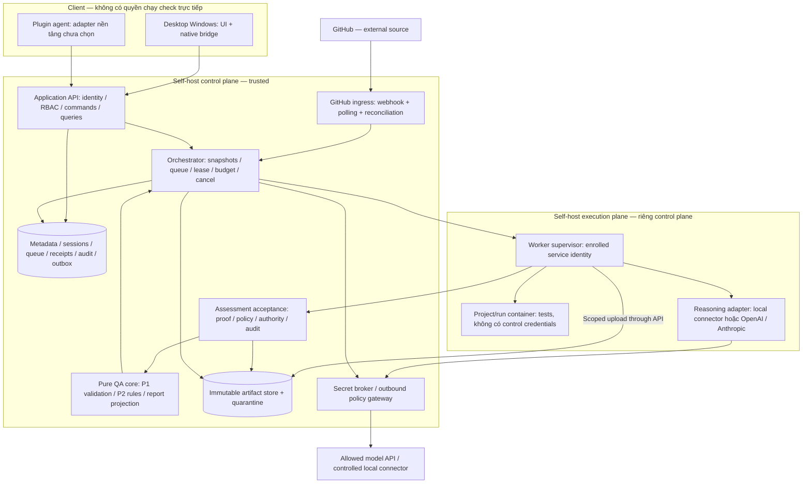

# P3 — Kiến trúc đích v1

Ngày 05/11/2026, nền `337ab82`. Đây là thiết kế đích, **chưa có các dịch vụ/runtime trong sơ đồ**. Hiện trạng chạy được chỉ gồm fixture và P1/P2 reference tooling. Yêu cầu: [PRODUCT-DECISIONS](PRODUCT-DECISIONS.md); contracts: [P1 v2](DATA-CONTRACT.md); semantics: [P2 v1](VERIFICATION-RULES.md). Synthetic trong repo, chưa pilot/publish.

P3 chia hai phần kiểm chứng được: **P3-A thiết kế ranh giới/luồng/trách nhiệm** tại đây; **P3-B quyết định stack sau spike** tại [ADR-003](adr/003-stack-and-spikes.md). P3 chưa đóng toàn bộ khi spike chưa chạy. Không lấy lựa chọn đề xuất thành công nghệ đã được người dùng chọn hoặc số đo tối ưu.

## 1. Toàn cảnh và đơn vị triển khai



Một deployment đầu: API/orchestrator/ingress là modular control service, một DB transactional, một artifact store, worker supervisor riêng; không tách microservice theo mỗi ô. Assessment/core là module trong control service; worker gọi API có scope, không truy DB/control secret trực tiếp. Reasoning adapter có thể là process do supervisor quản lý, mọi outbound project context đi qua gateway. Desktop đóng không đổi run; server/worker độc lập với desktop. Worker không có container engine thì check blocked/waiting có lý do; không fallback chạy test trên host.

Server có thể cùng máy với desktop nhưng vẫn là service độc lập. Baseline worker được đề xuất là Linux container host; Windows client không đồng nghĩa hỗ trợ Windows containers. Worker OS/engine và supported project toolchains phải qua P3-B; project chỉ chạy khi capability match. Host-plugin platform/manifest chưa chọn, không thêm MCP/SDK như quyết định ngầm.

## 2. Component và contract owner

| Component | Nhận | Thực hiện và trả | Boundary/failure |
|---|---|---|---|
| Desktop UI/native bridge | User intent, typed selection | Login, intake/start/cancel, bounded progress, report/source view/export | Không shell/engine/provider key; renderer không giữ refresh token; đóng UI không cancel |
| Agent client adapter | Host intent/capabilities | Cùng application commands/queries; upload candidate reasoning nếu được giao | Host context không tự được tin; không gửi dữ liệu project qua kênh ngoài policy |
| Identity/project service | Session/service credential | Principal, fixed-role grant, project config snapshot, capabilities | Auth mỗi request/read/stream/side effect; no self-claimed role |
| Intake service | repo/task hoặc handoff package | Stable task, immutable handoff/candidate, scoped artifact manifest | Limits, containment/archive checks, không chạy file/import hook từ gói |
| GitHub ingress | Verified delivery hoặc polling response | Receipt, canonical occurrence, dedup task/run intent | Ambiguous occurrence giữ unresolved, không tạo run kép theo phỏng đoán |
| Orchestrator | Authorized start/resume/cancel, job result | CAS run state, attempts/leases, budgets, durable work, progress | DB authoritative; external IO không nằm trong transaction kéo dài |
| Artifact store | Quarantine uploads | Server-computed content hash, immutable object, scoped read | Hash không chứng nhận actor; không public URL/path tùy ý |
| Worker supervisor/executor | Lease + trusted check config IDs | Checkout exact revision, run isolated checks, collect structured manifest | No arbitrary shell tool cho client/model, no host secret/socket in test container |
| Reasoning adapters | Policy-filtered context + bounded request | Candidate obligations/mappings/findings, cited locators, usage | Model output untrusted; timeouts/refusal/truncation/invalid JSON không là defect |
| Assessment acceptance | Candidate inference + proof + policy | Accepted/draft/disputed judgment facts, audit refs; P2 sidecar | Không tự chấp nhận chỉ vì model trả `accepted`; không khẳng định domain truth |
| Pure core | Validated frozen bundle + accepted-context sidecar | P2 assessment; P1 report projection + rationale/limitations | Không network/secrets/DB/shell; malformed input không là behavior fail |
| Persistence/event publisher | Proposed mutations | Atomic metadata transitions, append audit/outbox; replayable progress | No exactly-once external execution promise; no report before durable refs |

Interfaces nội bộ dùng data types/version độc lập framework web/desktop. Core không import adapter SDK. P4 port P1/P2 sang runtime đã chọn phải chạy cùng corpus và so structured status/reasons/refs; Python reference chưa tự trở thành production engine. Không có rule thứ hai trong UI/plugin.

## 3. Luồng từ intake đến report

```mermaid
sequenceDiagram
  participant U as Desktop / Plugin
  participant API as Application + Auth
  participant DB as DB / Outbox
  participant W as Worker
  participant G as Gateway / Reasoning
  participant A as Acceptance + Core
  U->>API: Import/resolve intake (project scope)
  API->>DB: Persist immutable task/handoff/artifact manifest
  U->>API: start_run + idempotencyKey + expectedProjectVersion
  API->>DB: Atomic authorize/version/dedup + queued run + outbox
  API-->>U: Accepted runId/stateVersion (không QA pass)
  W->>API: Claim available job (service identity)
  API->>DB: Atomic attempt/token/lease + stateVersion
  API-->>W: Frozen scope + scoped grants
  W->>G: Allowed context only; bounded reasoning request
  G-->>W: Candidate reasoning + provenance/usage
  W->>W: Run configured checks in isolated container nếu được phép
  W->>API: Quarantine artifacts + workerResult (fenced attempt)
  API->>DB: Check identity/lease/version; accept result metadata
  API->>A: Evidence/proofs + candidate reasoning + policy
  A->>A: Accept supported judgments; P2 evaluate; project P1 report
  A->>DB: Atomic report ref + completed + report_ready outbox
  API-->>U: Replay progress / query durable report
```

Đây là sơ đồ đường thành công, không bỏ validation trước analyze/check theo P1. Artifact bytes được stage trước; metadata chỉ published sau hash/length/scope checks. Nếu blob publish thành công nhưng transaction fail, object là orphan chưa readable qua API; sweeper dọn sau grace period. Nếu report validation fail, không đổi run completed; giữ diagnostic an toàn và fail/retry theo budget. Bundle và assessment là versioned inputs; report không đọc live branch hoặc live requirement.

Một vòng analyze → permitted checks → analyze phải bounded theo attempts/time/token/tool budget. Model chỉ đề nghị check ID đã có; không phát sinh/sửa code hoặc test. Missing source/connector không tạo evidence giả. Phần độc lập làm trước; nếu hết phần làm được thì completed + report incomplete + actions. Waiting chỉ khi có lý do tiếp tục cùng snapshot/budget; release lease và dọn container. Clarification đổi expected/config/candidate tạo snapshot/run mới có lineage, không mutate run cũ.

## 4. Trusted assessment: từ suy luận đến state

Không có thuật toán trong P2 tự chứng minh requirement decomposition hoặc domain truth. P3 dùng ba tầng:

1. **Candidate intake:** adapter chỉ được ghi candidate record, gắn run/attempt/source/model provenance. Bỏ qua hoặc từ chối mọi trường tự khai authority/accepted/role. Structured output đúng schema chưa là acceptance.
2. **Acceptance service:** resolve artifact/locator và exact versions; xác thực execution record từ enrolled executor hoặc giữ reported; kiểm integrity từ bytes, không từ nhãn. So policy cho risk/coverage/applicability/constraint và actor authority. Ghi assessor, source, policy/rule version, decision reason và pending/disputed nếu thiếu căn cứ.
3. **Rule evaluation:** tạo sidecar accepted facts từ state server đã kiểm, chạy P2, lưu snapshot input/output. Vẫn khai limitations cho judgment semantic do agent cung cấp; accepted theo policy không đồng nghĩa independent/human adjudication.

| Judgment | Auto-accept trong quyền đã cấu hình | Chờ owner/domain authority khi nào |
|---|---|---|
| Artifact identity/integrity | Server hash/manifest match; scope/revision checked | Không rõ nguồn/thay bytes/hash mismatch → unresolved |
| Execution attribution | Enrolled executor, check config/candidate/env/attempt record match | Imported log không có runner proof chỉ reported; không upgrade theo lời model |
| Obligation/context/assertion mapping | Project policy cho scoped agent judgment, source locators tồn tại, expected/assertion/context được giải thích và limitations lưu | No policy, source conflict, unsupported reasoning hoặc disputed mapping → candidate/disputed |
| Risk/coverage plan | Policy template có nguồn, fit scope; authorized assessor trong delegation | Unknown risk, yêu cầu vượt template hoặc thiếu domain decision → draft |
| N/A/mandatory review/completion | Exact actor/domain delegation + source/candidate/proof được resolve | Runner/agent không tự có quyền domain chỉ vì được start QA |

Không cần người dùng duyệt từng mapping khi đã ủy quyền phù hợp. Nếu policy không cho auto-accept một judgment, action chỉ rõ owner/assignee hoặc unknown và doneWhen. API không nhận `authorized=true` hay `donePredicateMet=true` từ client như sự thật. Lifecycle P2 helper chỉ chạy sau authority/proof graph resolution; append transition history, không overwrite verdict cũ.

Execution proof envelope nội bộ cần worker identity, project/run/attempt/token digest, exact candidate, trusted config/image digest, command/check ID, observed start/end/env, exit/outcome parser version, output object hashes; các field này **chưa là P1 wire schema**. Cần spec/schema transport ở P4 trước endpoint; provenance claim không tự thành attestation.

## 5. Report projection giữ semantics P1/P2

P2 output không phải P1 report. Projector v2 chỉ hỗ trợ subset mà P1 shape/graph và P2-derived consistency cùng biểu diễn được; không phải total mapping. Validate cả hai trước persist:

| P2/input | P1 projection |
|---|---|
| Criterion status + scope/reason codes | criterionResult status/rationale + limitations; không chỉ render số pass |
| evidenceIds/contextEvidenceIds | Đúng candidate/mapping; context không thành decisive execution |
| record_review | assessmentKind record_only, limitation record-only rõ |
| Conclusive execution_review, decisive current execution | execution_supported; vẫn nêu source reasoning/mapping limitations |
| Conclusive chỉ decisive source_reasoning | source_reasoning |
| Unverified không có basis đủ, hoặc N/A không có evidence conclusive | insufficient; N/A decision source ở rationale/claims, không bịa execution |
| hasUnverifiedMandatory, verification, mandatory constraints | Giữ đúng P1 aggregate; không từ completed suy complete |
| hasOpenMandatoryCoverage/per-AC open coverage | Giữ structured assessment attachment; diễn giải trong report/criterion limitations |
| Finding/action proposals | Candidate/proposed mặc định; confirmed/done chỉ sau accepted basis/authority |
| humanDecision | pending; không có QA auto-approval command |

Status unverified dù có evidence có thể dùng insufficient; không buộc gắn execution_supported chỉ vì có log. Projector phải giữ finding/action source/basis/transition audit và assessment reference trong server metadata bên cạnh strict P1 report. Không thêm field lạ hoặc artifact kind lạ vào P1 v2. Assessment/acceptance/audit attachments thuộc internal storage envelope có version riêng, không giả là QA artifact mà dataPolicy cho outbound. P4 phải formalize envelope và export manifest; nếu cần field typed mới trong report thì contract mới, không sửa v2 ngầm.

### Projection collision và fail-closed boundary

Có xung đột hiện hữu chưa được version hóa: P1 validator tính mandatory constraint từ frozen `handoff.constraints[].state`; P2 tính effective constraint sau accepted/current review. Ví dụ P-05 khai satisfied nhưng review thiếu/stale, mọi AC verified: P2 incomplete, còn P1 yêu cầu complete. Không có P1 report v2 trung thực trên nguyên handoff đó. Không sửa AC thành unverified giả, không nâng P2 complete hoặc mutate handoff để né validator.

Projector phải trả typed `projection_unsupported` cùng safe diagnostic, lưu P2 assessment/input/proof trong internal metadata và artifact quarantine, không publish P1 report/report_ready hoặc completed. Run chuyển failed với integration/contract terminal reason theo P1; đây không là defect behavior. Read API hiển thị operational failure + assessment tham khảo, không giả làm final report hợp lệ.

**P4-A prerequisite:** formalize versioned assessment-authoritative report/constraint extension (hoặc ADR canonical-derived snapshot có identity/lineage/raw-input provenance đầy đủ), rồi schema/validator/golden collision tests trước khi mở full handoff→report. Mặc định hướng ưu tiên là contract version mới tách declared/effective constraint, giữ v2 nguyên lịch sử; wire shape chưa được chốt ở P3-A. Giữ boundary fail-closed cho đến khi quyết định đó implemented. Table projection phía trên chỉ áp dụng khi không có collision, không chứng minh luồng offline toàn phần khả thi.

## 6. Storage, transactions và job ownership

Design chọn transactional metadata + immutable blob abstraction ([ADR-001](adr/001-boundaries-and-persistence.md)). PostgreSQL là candidate cho P3-B; chưa có DB/migrations chạy. Logical records:

| Nhóm | Keys/invariants |
|---|---|
| identities/sessions/memberships | System vs project role riêng; session revocation/auth epoch, no plaintext credentials |
| projects/configs/data policies/check registries | `(projectId, version)` immutable; current enabled/revoke state check live |
| tasks/handoffs/artifacts/evidence | Project + task refs + exact revision; DB foreign keys/scope enforcement và service policy |
| receipts/occurrences/poll cursors | Provider delivery unique; canonical occurrence unique; cursor sau durable normalize |
| commands/runs/attempts/check jobs | Idempotency principal scoped; CAS version; token unique; active lease server time |
| assessment candidates/decisions/results/reports | Immutable input/output versions; exact run report association; decisions source/basis |
| progress/outbox/audit | Per-run sequence unique; audit actor/version/redacted reason; transactional publish intent |
| blob registry/quarantine/retention | Project-scoped object access, hash/length, reference reachability, retention policy |

Atomic units bắt buộc: (a) idempotency receipt + queued run + initial progress/outbox; (b) claim attempt/token/lease + stateVersion; (c) worker result acceptance + evidence metadata; (d) report publication + completed + report_ready; (e) occurrence→initial run + poll cursor. Không dùng publish event trước commit. Outbox publisher có thể deliver trùng; client ignore sequence đã thấy. Retry transaction bounded; không retry external effect theo DB rollback như effect chưa xảy ra.

Scheduler enforce project concurrency và server global capacity trong cùng claim transaction; fairness tránh project lớn chiếm hết. Claim bằng lock/CAS; heartbeat không cho token cũ gia hạn. Lease expired khiến old result bị quarantine; supervisor stop local activity khi mất renewal và sweeper reconcile containers. **Không claim check tiếp khi cleanup attempt cũ chưa được xác nhận**. Network partition không đảm bảo test dừng tức thời; không gọi exactly-once execution.

Progress stateVersion chỉ tăng khi state đổi; heartbeat/append progress không tự làm result observedRunVersion stale. Phase transition responses trả current version/token; worker phải dùng version mới. Result stale được reject, worker query state rồi submit lại nếu vẫn đúng lease/phase, không tự rewrite proof. Cancellation và completion race serialize bằng CAS: một terminal transition thắng, completion sau cancelling không publish thành công.

Waiting không giữ container/secret/lease. Retry attempt trong cùng run chỉ khi immutable snapshot còn hợp lệ/budget; manual rerun có run mới và rerunOfRunId, trigger null. Terminal run immutable. Không auto-cancel run cũ khi revision mới: tạo run event mới nếu policy cho; UI đánh dấu candidate cũ trong read projection, không thêm state superseded vào enum P1.

Blob filesystem đầu có thể server-local volume, mọi worker upload qua scoped API; worker không dùng shared writable host folder. Blob store port cho object storage sau. Backup phải gồm DB + reachable blob versions + master-key recovery procedure; restore rehearsal trước P5. Retention không xóa proof còn referenced; orphan cleanup khác evidence retention. Secrets, audit và data backups có quyền/retention riêng; metadata audit không chứa nội dung source/raw prompt.

## 7. API, desktop bridge và phiên bản

Design chọn HTTPS JSON application API + replayable SSE progress, không gắn agent platform ([ADR-002](adr/002-transport-identity-and-execution.md)). Routes dưới đây là **interface inventory**, chưa là OpenAPI/server code. API version `/api/v1` khác domain contract `2.0.0` và rules `p2-rules-1.0.0`.

| Nhóm interface | Nội dung | Quyền |
|---|---|---|
| Auth | login/logout/refresh/self, admin account create/disable/reset | Internal accounts; admin quản lý account |
| Project admin | versioned config, secret write/rotate refs, membership, Owner transfer | Owner project; Owner grant/transfer do System Admin, không tự nâng quyền |
| Intake | upload bounded package; repo/task resolve; immutable handoff query | Runner/Owner/Admin trong project; provider ref đã đăng ký |
| Run commands | P1 start_run/cancel_run; typed waiting resume | P1 matrix; resume yêu cầu reason resolved và current auth/snapshot |
| Read | authorized project/run/report/source; paginated history; replay progress | Membership/current project scope, kể cả mọi stream chunk |
| Assessment | candidate submission; scoped clarification/adjudication/action transition | Assigned agent/service chỉ candidate; decisions kiểm domain authority |
| Worker | enroll/rotate/claim/heartbeat/stage result/cleanup acknowledgement | Enrolled worker + lease scope; không dùng user session |
| Integration | webhook receiver + admin subscriptions/poll reconciliation | Verify provider signature/repo; enabled project integration principal |

Đầu P4 phải viết OpenAPI/internal envelopes, payload limits, safe error taxonomy và compatibility tests cho nhóm đang implement; không invent endpoint bodies từ bundle rồi gọi production protocol hoàn chỉnh. Start trả 202 + runId/stateVersion; idempotency replay trả cùng result; auth 401, inaccessible resource 404, version/idempotency conflict 409, invalid payload 422, rate/budget admission 429, dependency unavailable 503. Forbidden action trên resource được phép biết có thể 403; không lộ secret/project khác qua error body. Safe envelope code/message/requestId/retryable, field paths khi được phép.

Desktop native bridge chỉ typed login/session/request/subscription/file-selection/export/open-source commands; không generic URL-fetch/shell invoke. Server origin do user/admin đăng ký, TLS verify không disable; credentials bind exact origin, redirect không mang auth sang origin khác, chặn metadata/private network fetch từ source URLs ở server. Renderer chỉ bundled assets, no remote scripts; source/report render escaped text/sanitized Markdown, cấm raw HTML/script. Source click dùng artifact ID/locator, server resolve quyền; URL ngoài mở system browser sau allowlist scheme, không navigate webview privileged.

SSE native bridge kèm session trong header, không token trong URL; bounded buffer/backpressure và reconnect exponential bounded. afterSequence replay hoặc snapshot required khi cursor hết retention. Snapshot phải có sequence watermark cùng consistent DB view để client replay phần sau không mất event. Disconnect không cancel; revoke session/project đóng stream ngay khi phát hiện và không phát thêm artifact bytes. Partial downloads cũng phải có deadline/revocation checks, tránh permanent signed public URL bypass quyền.

Version negotiation trước start: client/server supported API/domain/rules versions, adapter capabilities/limits; unsupported major reject rõ. Migration expand/contract, backup và schema compatibility check trước deploy; running runs pin engine/rules versions hoặc drain trước upgrade, không dùng rules mới hoàn tất run cũ ngầm.

## 8. Identity, secrets và quyền thay đổi giữa run

Internal account do admin tạo, first-admin bootstrap local one-time channel và buộc đổi credential; không default password. Password hash dùng maintained Argon2id implementation với parameters benchmark trên server theo [OWASP guidance](https://cheatsheetseries.owasp.org/cheatsheets/Password_Storage_Cheat_Sheet.html), không tự viết crypto. Login rate limit, generic failures, audit account resets. Opaque short-lived access session + rotating refresh stored hashed server-side; native client refresh credential trong OS credential store, không renderer/localStorage. Thời hạn/config cụ thể chốt trong auth spec P4 trước chạy server. SSO sau qua identity-provider port, không nhét domain roles vào claim chưa được map.

Admin cấp/transfer Owner; Owner chỉ gán Runner/Viewer trong project. Không xóa/disable admin cuối cùng; recovery qua documented local maintenance procedure có audit, không backdoor QA endpoint. Worker enrollment one-time token do admin phát hành, scoped service credential rotate/revoke, worker project allowlist. Principal client, worker và integration tách nhau. Human approval không nằm trong commands QA; decision authority không suy từ quyền start.

Secret store baseline thiết kế encrypted envelope per secret version, master key ngoài DB/backups ứng dụng và do operator cung cấp qua OS/secret service. Dùng maintained library/OS facility, key IDs/rotation và recovery rehearsal; chọn backend/library cụ thể ở P3-B/P4 security spec. API chỉ write/rotate/reference, không reveal qua UI/report/export; broker inject đúng adapter/check cần, không provider key vào test container. Unavailable key store → blocked/unavailable, không lưu plaintext tạm.

Snapshot cho reproducibility **không giữ quyền cũ**. Mỗi outbound/check/read/decision commit recheck live account/membership, project enabled, secret revocation và outbound-policy denial. Effective permission là intersection snapshot scope và live allowed scope: mở quyền mới không mở rộng run cũ; thu hẹp/revoke chặn ngay side effect tiếp theo, cancel/reconcile activity khi cần. Bytes đã gửi không thu hồi được; ghi audit, không hứa instant remote cancellation.

## 9. Worker, containers và model outbound

Executor chỉ nhận check config ID + immutable approved config, pinned image digest, exact checkout and output paths. Project Owner cung cấp config nhưng deployment policy vẫn chặn privileged mode, host network/mount, Docker socket trong test container; nonroot user, dropped capabilities, read-only source/rootfs phù hợp, tmp/output dirs tách, CPU/RAM/PID/disk/log/time limits. Build yêu cầu ghi file cạnh source phải dùng approved scratch copy, không sửa authoritative input; artifact hash/proof phân biệt copy/output. Không phù hợp thì blocked, không tự remount writable.

Supervisor thuộc execution host chuyên dụng, không cùng privilege DB/control secrets; engine access là đặc quyền chỉ supervisor có, không cấp cho reasoning process. Rootless engine là candidate giảm quyền theo [Docker docs](https://docs.docker.com/engine/security/rootless/), không chứng minh container an toàn. Worker capability registry phải kiểm các resource/network controls thực có; fail closed nếu host không enforce được. Run isolation không thay VM boundary cho hostile workloads; P5 đánh giá trust deployment trước dùng thật.

Container outbound default deny, chỉ explicit project service allowlist/network policy, network control ở runtime gateway/firewall có DNS/redirect controls; không chỉ truyền env HTTP_PROXY rồi coi đã enforce. Integration services cũng riêng run, disposable credentials/data, no production DB. Checkout không chạy git hooks/submodules/LFS tùy ý; fetch registered repository/revision bằng collector, no arbitrary URL/SSRF. Dependencies qua approved image/mirror/cache, không mở internet tự động khi test thiếu package.

Cancel chuyển cancelling rồi revoke new work, signal stop, hard stop sau grace, reconcile container/process/volumes, sau đó cancelled. Cleanup không xác nhận được → failed với safe terminal reason và orphan incident; sweeper tiếp tục cleanup, không âm thầm báo sạch. Labels run/attempt/container inventory giúp reconcile sau restart; output chỉ accepted sau fencing. Attempt namespace/cache không cho project khác đọc; cache key project/revision/tool/config và không reuse execution như evidence mới.

Output do test container tạo là input thù địch đối với supervisor. Thu file sau container đã stop/quiesced và không còn writer; hoặc stream qua helper nonprivileged isolated có giới hạn tương đương. Collector mở file rooted trong output namespace với no-follow/canonical containment ngay tại open (không chỉ precheck rồi open), chỉ regular files; từ chối symlink/junction/reparse/hardlink escape, device/FIFO/socket và path đổi giữa check/read. Dùng byte/file-count/depth/time caps trước hash/upload; không follow kết quả test tới host filesystem. Không đủ primitive enforce an toàn trên host đã chọn thì quarantine/blocked, không best-effort đọc bằng supervisor privileged. S4 phải thử output symlink escape, concurrent swap/FIFO và oversize.

Raw check output/stdout/stderr mặc định **tainted theo toàn read scope và secret access của check**, không được tự coi allowed chỉ vì artifact kind là test_output hoặc path output được allow. Check có thể copy denied source hoặc integration credential vào log. Gateway chỉ xuất khi lineage chứng minh mọi nguồn ảnh hưởng đều allowed, hoặc qua trusted extractor/redaction với scoped policy và tests đã được chấp nhận; không chứng minh được thì block outbound log và nêu gap. Secret-tainted raw output phải ở restricted quarantine, không thuộc ordinary artifact/source/read/export/stream/attachment APIs cho Viewer/Runner/Owner/Admin; QA role không cấp quyền reveal raw secret. Chỉ expose metadata hoặc trusted sanitized derivative được policy cho phép. Không dùng signed object URL hay report attachment để bypass; operator recovery ngoài QA API cần maintenance procedure/audit riêng. Secret-bearing checks không gửi raw output đến model mặc định; redaction không phải bảo đảm loại mọi secret. S4/S6/P5 thêm denied-source→allowed-output, credential→stderr và direct read/export/stream/attachment-denial cases, gồm source reasoning dùng output như dữ liệu derived.

OpenAI/Anthropic adapters riêng qua provider port: request bounded context, response candidate data, model/version/config/usage, normalized refusal/rate-limit/timeout/parse failures. Không gọi SDK ở pure core; model/service account thật chưa dùng trong repo. Token reservation trước call + usage reconcile, timeout/attempt budget, no silent provider fallback. Provider không có reliable limit/usage thì chặn automatic calls hoặc dùng conservative bound đã cấu hình; không hứa hard money cap. Raw prompt/response mặc định không log; lưu scoped source references và sanitized diagnostics.

Gateway chặn artifacts/kinds/paths/provider không allowed; deny thắng allow. Derived summaries phải giữ source lineage và quyền ít nhất nghiêm như sources; không gửi secret chỉ vì nằm trong summary. Local connector chỉ enabled nếu enrollment + context-scope + outbound/tool controls enforce được. Connector cần desktop/host đang tắt → waiting_permission/connector unavailable, làm phần độc lập và report incomplete; không fallback cloud. Uncontrolled host agent đã có workspace rộng không thể được gọi policy-compliant bằng một plugin wrapper; chưa chứng minh enforce thì không cấp context hoặc chạy mode đó.

## 10. GitHub polling/webhook: occurrence, revision và reconciliation

Webhook verify raw-body signature, enabled repo/subscription/type/action, body limits; persist bounded receipt trước ack. GitHub khuyến nghị HTTPS, secret và response nhanh; queue xử lý async theo [best practices](https://docs.github.com/en/webhooks/using-webhooks/best-practices-for-using-webhooks). Signature không thay repo/project authorization. Delivery ID chống redelivery receipt, không phải domain occurrence. Payload không trực tiếp cấp quyền check hoặc chỉ định trusted config.

`pr_ready` candidate adapter: webhook `pull_request` ready_for_review làm wakeup; polling và webhook reconciliation cùng đọc provider ready transition history để lấy canonical event ID. [GitHub timeline API](https://docs.github.com/en/rest/issues/timeline) và [issue event types](https://docs.github.com/en/rest/using-the-rest-api/issue-event-types) là nguồn cần kiểm bằng adapter fixtures/spike. Chưa có bằng chứng API response thực trong repo.

**Không map head SHA hiện tại thành revision của transition lịch sử**. Canonical occurrence cần event ID và candidate tại thời điểm đó, được chứng minh từ provider history/snapshot correlation. Webhook delivery đã lưu có transition payload nhưng không có common timeline ID thì pending correlation; timestamp gần nhau không tự đủ. Poller chỉ thấy current ready state không được bịa event ID/SHA lịch sử. Không resolve được common identity/revision thì receipt unresolved, nêu action/gap và không auto-create run; explicit manual start vẫn được. Đây là adapter-readiness gap phải khép P3-B/P4 trước claim đầy đủ polling+webhook automation.

Trước normalized event, internal unique `(project, integration/repo, kind, subject, occurrence)` bind đúng một immutable resolved revision. Cùng occurrence nhưng hai SHA → quarantine conflict/audit, không tạo run thứ hai; nếu run đã có thì giữ nguyên và mở incident, không mutate candidate. P1 public normalizedKey giữ nguyên. Delivery receipt uniqueness scope hook/integration; một receipt fan-out nhiều project qua mapping đã được cấp quyền, mỗi project receipt state riêng, không một project ack làm mất xử lý project khác.

Sau normalize: unique `project|kind|subject|occurrence|revision` → một initial run. Transition ready lần nữa cùng SHA là occurrence mới; webhook retry không là rerun. Không dùng updated_at hoặc delivery ID làm occurrence chung. Cursor có thể advance sau durable receipt chỉ khi mọi pending item vẫn nằm trong durable reconciliation backlog và không bị bỏ qua bởi checkpoint; correlation-to-run commit atomic với item state. Cursor không được làm mất unresolved item; overlap replay window, paginate đến hết, lưu boundary/catch-up state, handle rate limit/deleted/inaccessible history. Missed transition không thể phục hồi thì công bố gap, không claim event coverage 100%.

Dev/QC handoff được đưa vào qua authenticated application submit với stable producer handoff occurrence/version; GitHub issue/PR label/comment chỉ có nghĩa handoff khi project định nghĩa convention có nguồn. Bản đầu không tự hiểu mọi comment là bàn giao. Hai intake vẫn tạo cùng handoff normalized. Poll interval/concurrency/rate quota Owner cấu hình trong server caps, không lấy specimen budget làm default.

## 11. Quan sát, errors, hiệu năng và verification plan

Audit có principal/project/run/attempt/request, operation, decision/reason, versions, proof refs; no tokens/password/raw source. Progress cho reviewer nêu phase/candidate, đã kiểm gì, gap, người xử lý và doneWhen. Operational metrics: queue age, lease churn, cleanup pending, outbound denied, token reserved/used, event unresolved, replay lag. Không biến số findings/pass thành chất lượng hay ROI. Log retention/redaction/access tests thuộc readiness.

| Failure path | Hành vi mong đợi / check P4/P5 |
|---|---|
| Invalid/oversize/archive traversal/symlink intake | Reject/quarantine, no code execution hoặc object read ngoài scope |
| Membership/session revoke lúc stream/check/model chạy | Stop new effects/reads, close stream, reconcile work; audit dữ liệu đã rời boundary |
| Hai start cùng key hoặc webhook+polling trùng | Một accepted initial run; body khác 409; ambiguous identity unresolved |
| Hai workers claim/race lease expiry/cancel/complete | CAS winner, stale result quarantined, no overlap check trước cleanup |
| DB/blob/publisher crash ở mỗi commit boundary | No dangling published report; outbox replay; orphan quarantine cleanup |
| Output chứa symlink/FIFO/swap/oversize hoặc denied data trong allowed log | Collector no-follow/quiesced/caps, taint-aware outbound chặn trước gửi; không đọc host secret |
| Container engine/network controls unavailable | No host fallback, reason blocked/waiting, phần độc lập tiếp tục |
| Provider timeout/refusal/malformed/truncated response | No defect fabricated; bounded retry rồi gap/partial |
| Raw model tự khai accepted/authorized/done | Reject/strip candidate authority; no state escalation |
| UI đóng/mở/reconnect/out-of-order events | Run tiếp, snapshot watermark + replay, no duplicate action |
| P2→P1 projection mất open coverage/provenance hoặc declared/effective constraint collision | Golden collision trả projection_unsupported, no report/completed; versioned contract fix trước full projection; corpus parity |

Budget/spike tại ADR-003 là **engineering targets**, chưa số đo hoặc SLA được người dùng duyệt. Không chạy load/pilot project thật. Fault/concurrency integration tests phải dùng DB/engine đã chọn trước gọi gate đạt; reference unit green không thay chúng.

## 12. Trình tự P3-B/P4 và tiêu chí bàn giao

1. P3-B: bounded spikes chọn runtime/schema parity, transactional queue, desktop shell và container host; xác minh GitHub common occurrence/revision khả thi. Ghi actual environment/output hoặc chưa chạy, không điền benchmark giả.
2. P4-A: khép report/constraint collision bằng versioned contract trước full projection; pure core + partial projector fail-closed rồi synthetic headless harness, no model/network; typed internal assessment/export manifest trước persistence.
3. P4-B: auth/project/config + intake/API/DB/immutable blob/outbox, tests RBAC/revoke/concurrency; admin/secret interfaces spec trước exposed endpoint.
4. P4-C: worker enrollment/lease/check container/cleanup; fake providers và fake local connector; trusted assessment pipeline, policy/budgets/audit. Fake không là actual execution/provider readiness.
5. P4-D: GitHub polling/webhook adapter fixtures, OpenAI/Anthropic contract adapters, host-neutral connector protocol; không account/project thật trong repo. Platform plugin package vẫn phụ thuộc target người dùng chọn.
6. P4-E: Windows desktop typed bridge cùng API, start/progress/cancel/report/source/export; screenshots/flow verification và headless parity. P5 full failure/security/performance checks, P6 package/deployment/installer candidates sau.

P3-A có design/component/sequence/dataflow, rule/judgment owner, permission/errors/storage/version và traceability tại [P3-REVIEW](P3-REVIEW.md). P3 tổng thể **partial** tới khi P3-B có kết quả và ADR stack được chốt; không bỏ spike để gọi kiến trúc đã chứng minh khả thi. Agent target chưa chọn chỉ chặn platform packaging, không chặn core/API design. Chưa có installable app/plugin/server, chưa pilot/public release.
