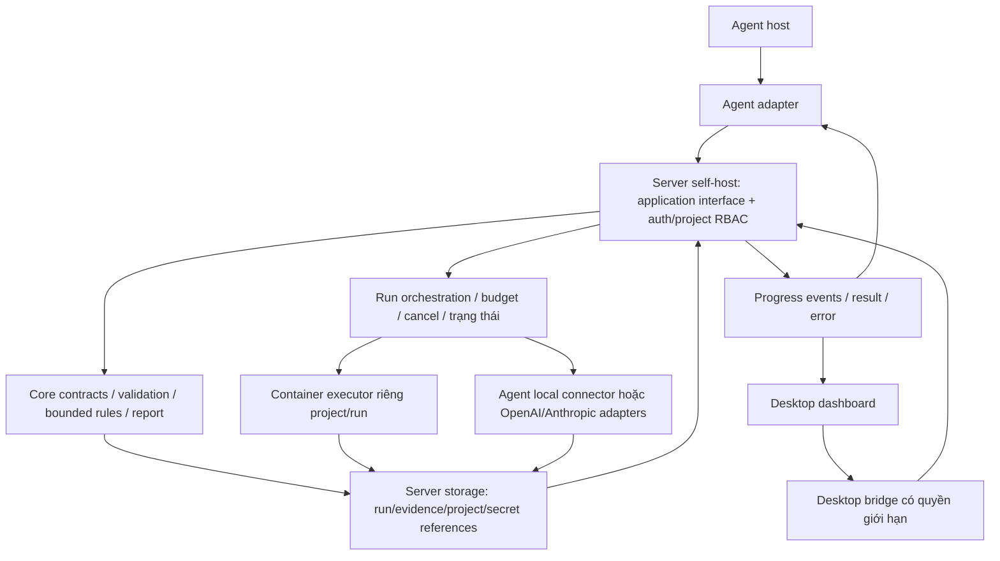

# Định hướng kỹ thuật — plugin và desktop dùng chung lõi

Ngày 05/11/2026, nền `e40d4e3`. Người dùng muốn plugin cùng ứng dụng desktop có dashboard và kỹ thuật phù hợp để tối ưu; đã chọn **Windows trước, giữ khả năng mở rộng macOS/Linux**. Đây là định hướng để P1/P3 lựa chọn, **chưa là ADR chốt stack hoặc implementation**. Agent target còn chưa chọn, không hứa cả ba OS ở bản đầu.

## Yêu cầu bổ sung sau khảo sát

[PRODUCT-DECISIONS](PRODUCT-DECISIONS.md) cập nhật runtime local agent hoặc API theo project, hai intake, GitHub events và outbound data policy. Không còn giới hạn phần reasoning chỉ dùng host agent; local-first là lưu trữ/triển khai bản đầu, không đồng nghĩa tuyệt đối offline khi người dùng chọn API. Người dùng đã chọn OpenAI/Anthropic adapter riêng và worker/server xử lý khi app đóng. Worker self-host và config/repo/data/secret store theo project trên server đã chốt; đã chọn multi-user/project RBAC, container theo project/run và polling+webhook; auth nội bộ do admin quản lý, fixed roles Admin/Owner/Runner/Viewer, SSO sau đã chốt; local-first trước đó không còn nghĩa run gắn desktop process.

## Cập nhật phạm vi triển khai

Lựa chọn server self-host nhiều người/project RBAC thay giới hạn local-only ở bản định hướng trước. Dashboard Windows là client; một core dùng cho UI/plugin/server. Candidate SQLite local phía dưới là nghiên cứu trước mở rộng server, **chưa là lựa chọn storage cho server đa người**. P3 phải đánh giá storage/queue/concurrency, auth/tenant-project boundary và secrets cho phạm vi mới; không giữ khẳng định chưa có server/RBAC ở bản đầu.

## 1. Một sản phẩm, hai cách dùng

UI không chứa bộ rule thứ hai và không trực tiếp có shell/filesystem không giới hạn. Plugin hoạt động headless, không bắt buộc mở desktop. Desktop có thể xem/import evidence và chạy phần deterministic của core mà chưa có agent; phần cần reasoning phải qua connector agent hoặc API adapter đã cấu hình theo project. Nếu thiếu connector thì trả waiting/unsupported có lý do, không giả vờ dashboard tự có AI.

Core/workflow có interface chung; cùng input/rule version cho kết luận rule tương đương giữa desktop và plugin. Reasoning host không hứa deterministic. Cần ownership của run và command ID để tránh cả UI/agent chạy cùng một check hai lần; chi tiết ở P1/P3.

## 2. Dashboard có chức năng thực tế nào?

Bản đầu thiết kế một luồng: chọn/import gói handoff synthetic → xem candidate và nguồn → bắt đầu run → theo dõi progress/log có giới hạn → đọc AC/evidence/findings/actions → export report. Có cancel, trạng thái thiếu dữ liệu/quyền/agent và mở nguồn trong scope được phép. Run history và so revision giúp truy lại kết quả; chưa làm analytics quản trị department hoặc dịch vụ cloud.

Dashboard là client vận hành của core, không chỉ là đồ thị số test. Không suy số test pass thành chất lượng chung. Decision người review ghi riêng; không tự merge/deploy/approve. Nút UI chỉ gọi command đã định nghĩa, không truyền shell text tùy ý từ nội dung evidence.

## 3. Cách hiểu “tối ưu” và gate chọn công nghệ

Tối ưu theo nhu cầu đo được: startup/idle memory/package size, UI responsiveness khi check đang chạy, throughput theo kích thước gói, thời gian cancel, độ đúng/reproducible, packaging/update và công bảo trì. Chưa có số đo hay nhu cầu scale đủ để chốt ngưỡng hoặc gọi một stack “tốt nhất”. P3 phải nêu acceptance budget trước spike/benchmark; so cùng dữ liệu và build mode, ghi máy/OS/runtime.

Ưu tiên thiết kế:

- Self-host server có tài khoản nội bộ và quyền project; desktop Windows là client, không bắt buộc dịch vụ cloud do sản phẩm vận hành. Network/provider calls theo project/data policy, không giữ giả định offline/local-only trước đó.
- Một core/rule contract; hai client không tự nhân đôi business logic.
- Check chạy ở worker/process riêng để UI phản hồi; UI virtualization/pagination/log batching khi dữ liệu thực đo cần, không render toàn bộ evidence lớn.
- Persist run metadata và references có version, lưu evidence file riêng theo thiết kế; không serialize file lớn vào UI state mỗi lần progress.
- Bounded concurrency theo CPU/I/O/tool, timeout/cancel/process-tree handling; không mặc định nhiều agent hoặc song song vô hạn nhanh hơn.
- Cache theo content + revision + rule/config/tool version; reasoning chỉ cache khi xác định được context/model provenance. Không dùng kết quả cũ sau khi candidate đổi.
- IPC/API validate input ở bên có quyền, capability-scoped commands, redact secret, không biến artifact thành instructions thực thi.
- Test core trước, contract tests giữa client/adapter và core, rồi end-to-end invocation/desktop lifecycle; fault tests cho disconnect/cancel/restart.

Đây là quyết định thiết kế định hướng của dự án, không phải tính năng đã hiện thực hoặc số đo hiệu năng.

## 4. Các lựa chọn desktop cần so ở P3

| Phương án | Căn cứ kỹ thuật từ tài liệu chính thức | Tradeoff dự án cần kiểm chứng |
|---|---|---|
| Tauri + giao diện web typed | Tauri có Rust core process và WebView dùng thư viện OS; capability giới hạn quyền theo window/webview | Cần Rust/native tooling, kiểm khác biệt WebView theo OS; nếu core là runtime khác thì đóng gói/giám sát sidecar làm tăng phần phải bảo trì |
| Electron + giao diện web typed | Electron có main/renderer và utility process; IPC/context isolation phải được cấu hình đúng | Có thể thuận tiện nếu core chọn Node/TypeScript; vẫn phải đo package/idle/startup và vận hành worker, không cho renderer truy Node/shell tùy ý |
| Shell native khác | Chỉ xét khi P1/P3 cho thấy ràng buộc OS/accessibility/native integration cần | Không thêm một stack chỉ vì “native”; phải so reusable core, team/tooling và chi phí adapter |

React/TypeScript là một ứng viên UI, chưa chốt thay cho việc chọn contract/core runtime. Nếu chọn Tauri, tránh viết lại rule trong Rust và runtime khác cùng lúc. Nếu chọn Electron, tách pure core khỏi API Electron để plugin dùng lại. Chưa có bằng chứng đủ để chọn Tauri hay Electron là phương án tối ưu toàn cục.

Nguồn chính thức đã tra ngày 05/11/2026: [Tauri process model](https://v2.tauri.app/concept/process-model/), [capabilities](https://v2.tauri.app/security/capabilities/); [Electron process model](https://www.electronjs.org/docs/latest/tutorial/process-model), [security](https://www.electronjs.org/docs/latest/tutorial/security/). Các tradeoff/ưu tiên là suy luận thiết kế của dự án từ các khả năng đó, không phải benchmark nhà cung cấp.

Tauri có cơ chế bundle sidecar nhưng binary phụ thuộc OS/architecture; không coi core viết runtime bất kỳ sẽ tự thành binary desktop đa nền tảng. Xem [external binaries](https://v2.tauri.app/develop/sidecar/). Chốt build/upgrade/cancel compatibility trong ADR.

## 5. Storage và phân phối

SQLite là ứng viên lưu run metadata cục bộ, evidence lớn có thể lưu file và reference. Chưa chốt database/driver, schema/migration hoặc WAL. Nếu chọn WAL, cần hiểu concurrent readers/single writer, filesystem local và checkpoint; không dùng một DB file mạng cho nhiều máy. Căn cứ: [SQLite WAL](https://www.sqlite.org/wal.html). Không bật tối ưu mà chưa kiểm phiên bản/durability/recovery.

Release cần hai loại artifact: agent adapter package và desktop installer cho OS được chọn, cùng core/version compatibility. Kiểm clean install/upgrade/uninstall, migration/rollback, process cleanup, workspace permissions và export. Signing/update channel/marketplace là thiết kế riêng, không tự phát hành public hoặc cài vào môi trường thật từ scope này.

## 6. Trình tự thực hiện

P1 bổ sung command/event/run-state/storage reference và capability của UI/agent. P2 giữ rule dùng chung. P3 chốt target architecture và ADR core/runtime/desktop shell/transport/storage dựa trên tiêu chí và spike giới hạn. P4 xây core/harness trước rồi một luồng desktop và headless dùng chung. P5 kiểm correctness, IPC/permission, cancel/restart và hiệu năng theo budget. P6 đóng gói các target đã chọn; không hứa mọi OS/agent ở release đầu.

Không tạo dashboard demo tách core để coi sản phẩm đã có. Hiện chưa có code desktop/plugin; as-is audit và fixture/evidence cũ giữ nguyên. Vẫn chưa pilot/E3/public publish.
